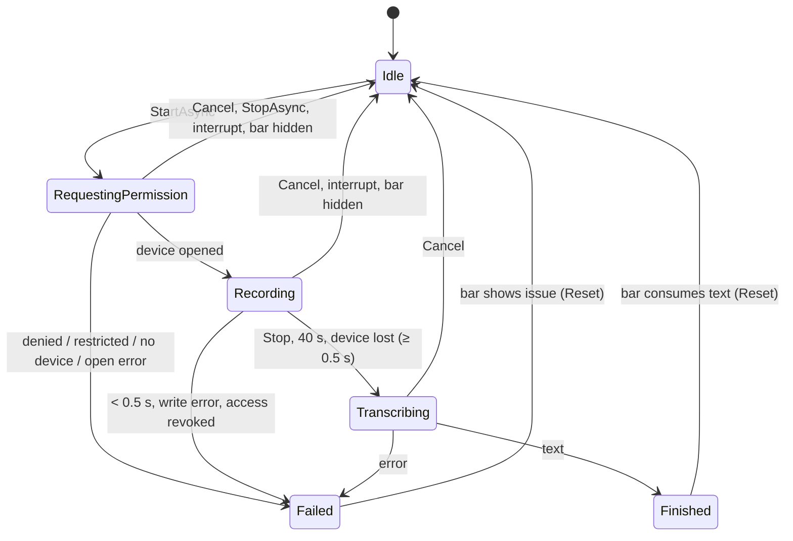

# AI Reply for Windows — voice dictation

Scope: microphone capture, the dictation state machine, level metering for the waveform, the temporary recording file,
the upload to `POST /api/v1/ai/transcribe`, error mapping, and the voice parts of the quick bar, tray menu and Settings.
Wire rules shared with other endpoints (headers, refresh, `ApiException`, installation registration) live in
`api-contract.md` and are only referenced here (`API §n`). Target: behave exactly like the macOS app at `0200bc8`
(2026-11-03), except where marked.

This file supersedes `AirReply-Windows/Docs/ARCHITECTURE.md` lines 56-58 (`AudioGraph`, M4A/AAC) and the voice types at
lines 69-86 and 134-149: the stack is Avalonia 12 + NAudio.Wasapi 3.3.0 and the recording is WAV (§1).

## 0. Conventions

| Prefix | Path |
| --- | --- |
| `MV:` / `MVT:` | `AirReply-macOS/Packages/AirReplyKit/Sources/AirReplyVoice/` / `…/Tests/AirReplyVoiceTests/` |
| `MUI:` / `MUT:` | `…/Sources/AirReplyUI/` / `…/Tests/AirReplyUITests/` |
| `M:` / `MT:` | `…/Sources/AirReplyCore/` / `…/Tests/AirReplyCoreTests/` |
| `B:` | `ai-reply-back-end/` |
| `STR:` | `AirReply-macOS/AirReply/Localizable.xcstrings` (line of the key) |
| `DES:` | `AirReply-macOS/Docs/DESIGN.md` |
| `ARCH:` | `AirReply-Windows/Docs/ARCHITECTURE.md` |
| `API §` | `AirReply-Windows/Docs/spec/api-contract.md` (sibling spec) |
| `AUD` | `docs/audits/2026-11-03-backend-macos-audit.md`, cited by finding id (file still being edited) |

Markers: **(fix vs macOS)** = audit defect (or a defect found while writing this spec, said so), Windows does the correct
thing. **(Windows)** = Windows-only adaptation, reason given. Unmarked = macOS parity. MUST / MUST NOT are binding.

Audit items: MAC-1…MAC-6 do not touch voice — the transcribe request never carries `output_char_limit`, `context`,
`template_id` or a recipient, and voice stores nothing per account. PRO-1 / PRO-9 apply (§6.7, §8.2).

## 1. Decisions (macOS → Windows)

| Topic | macOS | Windows |
| --- | --- | --- |
| Capture | AVAudioEngine input tap, new engine per recording (`MV:AudioCapture.swift:26-27,91-121`) | NAudio.Wasapi 3.3.0 `WasapiCapture`, shared mode, polling, 100 ms buffer, new instance per recording (§10.2) |
| Device | system default input, follows default changes (`MV:AudioCapture.swift:47,131-146`) | `GetDefaultAudioEndpoint(DataFlow.Capture, Role.Console)`, same follow rules (§10.4) |
| Permission | AVCaptureDevice status + system prompt (`MV:SystemMicrophonePermission.swift:11-27`) | registry consent pre-check + `E_ACCESSDENIED` from WASAPI; desktop apps have no request API (§10.3) |
| File sent | AAC-LC 16 kHz mono 32 kbps `.m4a`, `audio/mp4`, `voice.m4a` (`MV:CaptureWriter.swift:6-8,28-33`, `MV:VoiceController.swift:94-95`) | PCM s16le 16 kHz mono WAV, `audio/wav`, `voice.wav`; 40 s = 1 280 044 B (§5) |
| Conversion | AVAudioConverter, all channels downmixed (`MV:CaptureWriter.swift:141-147`) | Windows audio engine via `AUTOCONVERTPCM` + `SRC_DEFAULT_QUALITY` (NAudio sets both in shared mode); in-process fallback (§10.2 r.3) |
| Temp file | `$TMPDIR/AirReplyVoice/<UUID>.m4a`, deleted after upload or cancel, leftovers > 1 h removed at launch (`MV:VoiceController.swift:96-98,215,330-332,355-367`) | `%TEMP%\AirReplyVoice\<guid>.wav`, same rules + `FileOptions.DeleteOnClose` (§5.2) |
| Interrupts | sleep, screen lock (`MV:VoiceController.swift:336-353`) | suspend, session lock + **(Windows)** console/remote disconnect, display off (§10.5) |
| Errors | 9 kinds + `server(code)` (`MV:VoiceController.swift:13-28`) | + `ConsentRequired`, `SignedOut`, `AccountDisabled`, `ProDeviceLimit/Identity/Revoked` (§8) |

## 2. Product behaviour

### 2.1 Availability and entry points

1. The mic button exists only when `GET /api/v1/config` has `features.voice_transcription == true`
   (`MUI:QuickBarView.swift:141`, `MUI:QuickBarModel.swift:227`, `M:Models.swift:321`). Missing flag = off
   (`M:Models.swift:319`); before the first config load the fallback has no features, so no mic (`M:Models.swift:324`).
   Config is cached 300 s and refreshed when the bar opens (`M:AccountStore.swift:81-87`,
   `MUI:QuickBarModel.swift:170-175`).
2. Server side the flag = `TRANSCRIBE_ENABLED` (default `true`, `B:config/config.go:470`) ∧ OpenAI key set
   (`B:config/config.go:189-191`) ∧ transcriber wired (`B:internal/transport/api/transcribe_handlers.go:47-49`,
   `B:internal/transport/api/me_handlers.go:296-298`, `B:cmd/server/main.go:349-350`).
3. Mic button: 30×30 circular plain icon button, glyph Microphone (U+E720, Segoe Fluent Icons), secondary colour, hover
   fill primary 8 %, tooltip + accessible name `bar.mic`, shortcut **Ctrl+D** (macOS ⌘D), disabled while a generation
   runs (`MUI:QuickBarView.swift:141-145,167-187`). It sits between the text field and Send (`DES:32`).
4. Tray menu item `menu.dictate` directly under "Open", only when voice is available ∧ signed in
   (`MUI:StatusItemController.swift:51-53`, `DES:95`). Click → show the bar; if the voice phase is Idle → toggle (start)
   (`MUI:AppCoordinator.swift:108-111`). It does not check for a running generation (parity).
5. Toggle (mic button, Ctrl+D, tray) (`MUI:QuickBarModel.swift:536-548`):
   - Recording → `StopAsync()` (stop and transcribe).
   - Idle / Finished / Failed → if not signed in, or consent is needed → do nothing, silently. Else clear the current
     issue, `Reset()` when not Idle, `StartAsync(settings.DictationLanguage)`.
   - RequestingPermission / Transcribing → ignored.

### 2.2 The bar while voice is active

1. Phase ≠ Idle hides the copied-message capsule and the manual reply-source field (`MUI:QuickBarView.swift:56-58`).
2. RequestingPermission or Recording → the input row is replaced by the recording row; Transcribing → the transcribing
   row; otherwise the input row (`MUI:QuickBarView.swift:71-78`). The context toolbar above and the advanced-context
   panel below stay.

Recording row (`MUI:QuickBarView.swift:293-335`): horizontal stack, spacing 12, padding 16 horizontal / 12 vertical.

| Element | Spec |
| --- | --- |
| Dot | 8×8 circle, system red; opacity 1 in Recording, 0.4 in RequestingPermission (`:301-304`). Static: DES:62 says "pulsing", the code has no pulse — code wins. |
| Waveform | fills the free width, height 28, excluded from UI Automation (`:305-307`); §4 |
| Timer | `{m}:{ss} / {m}:{ss}` = floor(Elapsed) / MaxDuration, e.g. `0:07 / 0:40`; 12 px medium, tabular digits, secondary (`:308-310,331-334`) |
| ✕ | icon button, glyph Cancel (U+E711); tooltip + name `voice.cancel` → `CancelVoice()` (`:311`) |
| ✓ | 32×32 accent circle, white CheckMark (U+E73E) 13 px bold; tooltip + name `voice.stop`; Enter; enabled only in Recording → toggle = stop (`:312-323`) |
| Row | UIA container name `voice.recording` (`:327-328`) |

Waveform (`MUI:QuickBarView.swift:337-357`): N = 40 bars, spacing 3, bar width `max(2, (W − 3·(N−1)) / N)`, bar height
`max(3, level·28)`, capsule (radius = width / 2), accent colour, vertically centred. Height changes animate linearly over
80 ms; no animation when Windows animations are off (`SystemParametersInfo(SPI_GETCLIENTAREAANIMATION)` = FALSE, the
Reduce Motion equivalent). DES:61's "2 pt wide" bars are not what the code draws: at 680 px the bars are ≈ 8 px wide.

Transcribing row (`MUI:QuickBarView.swift:359-375`): small indeterminate progress ring, `voice.transcribing` 15 px
secondary, spacer, ✕ (`voice.cancel`); padding 16 / 14. No shimmer (DES:64 mentions one; the code never uses its state).

### 2.3 After transcription — insert, never generate

Handled on the next UI-thread turn after the phase change (`MUI:QuickBarModel.swift:555-587`):

1. Finished(text): `spoken = Trim(text)`; `Reset()` the recorder.
2. `spoken` empty → issue NothingHeard (`voice.issue.nothing_heard`); draft untouched (`:571-574`).
3. Else `current = Trim(draft)`; `draft = current == "" ? spoken : current + " " + spoken` (the user's trailing spaces and
   newlines are dropped — parity); focus the text field, caret at the end (`:575-577`, `DES:64-65`).
4. Nothing is sent. Generation starts only on Enter, Send or a recipient chip (`DES:13`, `DES:65`,
   `B:internal/ai/transcribe.go:14-16`). Auto-stop at 40 s and device loss upload the audio for transcription only.
5. The text is never truncated. Over `max_instruction_length` the counter shows and Send is disabled
   (`MUI:QuickBarModel.swift:239-241`, `MUI:QuickBarView.swift:138-140`).
6. **(Windows)** The Enter that stopped recording MUST NOT submit: handle it on KeyDown (`Handled = true`), and ignore Enter
   KeyDown in the text field until an Enter KeyUp has been seen after the stop (auto-repeat would otherwise submit the
   moment the text appears).
7. Failed(kind): `Reset()`; `ConsentRequired` → `RefreshMeAsync()` so the consent card replaces the issue
   (`MUI:QuickBarModel.swift:578-583`, `MUI:QuickBarView.swift:90-95`); show the issue (§8.3).
8. Only phase *transitions* into Finished/Failed are handled (the `Changed` event also fires 30×/s for levels and time).

### 2.4 Keyboard (`DES:116-119`)

| Key | When | Action | Source |
| --- | --- | --- | --- |
| Ctrl+D | input row visible (voice Idle) | start | `MUI:QuickBarView.swift:143` |
| Enter | Recording | stop and transcribe | `MUI:QuickBarView.swift:320` |
| Enter | RequestingPermission, Transcribing | nothing (no Enter target in the row) | |
| Esc | RequestingPermission, Recording, Transcribing | `Cancel()` only; the bar stays | `MUI:QuickBarModel.swift:369-376` |
| Esc | voice Idle | cancel a running generation, else hide the bar | `MUI:QuickBarModel.swift:377-381` |

### 2.5 Exit paths ("the microphone is closed in every exit path", `DES:66`)

| Event | RequestingPermission | Recording | Transcribing | Source |
| --- | --- | --- | --- | --- |
| ✕ | Cancel + focus field | Cancel + focus field | Cancel + focus field | `MUI:QuickBarModel.swift:550-553` |
| Esc | Cancel | Cancel | Cancel | `MUI:QuickBarModel.swift:369-376` |
| ✓ / Enter / toggle | — (✓ disabled) | stop → upload | — | `MUI:QuickBarModel.swift:536-548` |
| Bar hidden (global hotkey toggle, explicit hide) | Cancel | Cancel | continues; text lands in the draft (kept 10 min) | `MUI:QuickBarModel.swift:158,186-189` |
| Bar deactivated (focus loss) | bar stays | bar stays | bar stays | `MUI:QuickBarModel.swift:191-198`, `MUI:QuickPanel.swift:65-66,152-154` |
| 40 s reached | — | stop → upload | — | `MV:VoiceController.swift:242-248` |
| Device lost | — | finish with what was said (§3.4 r.6) | — | `MV:VoiceController.swift:258-270` |
| Sleep, screen lock | Cancel | Cancel | continues | `MV:VoiceController.swift:347-353` |
| **(Windows)** console/remote disconnect, display off | Cancel | Cancel | continues | §10.5 |
| App exit | Cancel | Cancel | Cancel | `MUI:AppCoordinator.swift:84-87` |

### 2.6 Settings, diagnostics, privacy

1. Settings › Voice (`MUI:SettingsWindow.swift:125-148`): picker `settings.dictation_language` with `language.auto`,
   `Русский`, `Қазақша`, `English` (verbatim); caption `settings.voice.footer`; row `settings.microphone` with button
   `settings.open_system_settings` → `ms-settings:privacy-microphone`. No status readout (DES:110-111 asks for one; the
   code shows only the button — parity).
2. Stored value `DictationLanguage`, raw `auto|ru|kk|en`, default `auto` (`MUI:AppSettings.swift:40,53,65`); persisted in
   `%LOCALAPPDATA%\AI Reply\settings.json` (`ARCH:53-55`) as the raw string.
3. "Copy diagnostics" carries only `Voice: on|off` (`MUI:AppCoordinator.swift:261`) and the last issue kind.
4. Logs: phase changes, error kinds and server codes, HRESULTs in hex, durations, byte counts, `request_id`,
   `X-Request-ID`. Never audio, transcripts or device names (`DES:132-134`).

## 3. State machine

### 3.1 Phases (`MV:VoiceController.swift:30-37,75-76`)

| Phase | Meaning | Microphone | File |
| --- | --- | --- | --- |
| Idle | nothing in progress | closed | none |
| RequestingPermission | privacy pre-check + device open (may wait on a Windows consent dialog, §10.3) | opening | created, empty header |
| Recording | capture running | open | being written |
| Transcribing | upload in flight | closed | complete; deleted when the upload ends |
| Finished(text) | transient; the bar consumes it and calls `Reset()` | closed | deleted |
| Failed(kind) | transient; the bar consumes it and calls `Reset()` | closed | deleted |

Observable: `Phase`, `Text` (Finished), `Error` + `ErrorCode` (Failed), `Levels` (40 floats), `Elapsed`, `MaxDuration`
(`MV:VoiceController.swift:80-85`). Every member runs on the UI thread; capture callbacks are marshalled to it (§10.2).

### 3.2 Constants

| Name | Value | Source |
| --- | --- | --- |
| `MaxDuration` | 40 s (= server `MaxVoiceSeconds`) | `MV:VoiceController.swift:116`, `B:internal/ai/transcribe.go:27` |
| `MinimumDuration` | 0.5 s of written audio | `MV:VoiceController.swift:90-91` |
| `TickInterval` | 100 ms | `MV:VoiceController.swift:92` |
| `LevelCount` | 40 (one per 50 ms → last 2 s) | `MV:VoiceController.swift:87-88` |
| `LevelInterval` | 50 ms = 800 frames at 16 kHz | `MV:CaptureWriter.swift:177-182` |
| `LeftoverAge` | 1 h | `MV:VoiceController.swift:93` |
| `SampleRate` | 16 000 Hz, mono | `MV:CaptureWriter.swift:6` |
| upload minimum | 300 ms | `MUI:Support.swift:102-103` |
| `duration_ms` cap | 40 500 | `MUI:Support.swift:106` |
| upload timeout | 75 s per attempt | `MUI:Support.swift:114`, API §2.1 |

### 3.3 Diagram



### 3.4 Rules

1. **StartAsync(language)** (`MV:VoiceController.swift:142-160,201-240`)
   1. Idle → go on; Finished/Failed → `Reset()` then go on; RequestingPermission/Recording/Transcribing → return
      (`MVT:VoiceControllerTests.swift:214-231`).
   2. `attempt = ++generation`; remember `language`; Phase = RequestingPermission.
   3. Privacy pre-check (§10.3): Restricted → Failed(PermissionRestricted); Denied → Failed(PermissionDenied). The device
      is never opened (`MVT:VoiceControllerTests.swift:11-34`).
   4. Create the directory and the temp file (§5.2); failure → Failed(RecordingFailed) (`MV:VoiceController.swift:216-221`).
   5. Open the capture off the UI thread with a token cancelled by this attempt's `Cancel()`. It throws
      `VoiceException(PermissionDenied | NoInputDevice | RecordingFailed)` → delete the file; if the attempt is still
      current → Failed(kind) (`MV:VoiceController.swift:222-233`, `MVT:VoiceControllerTests.swift:249-257`). Any other
      exception → RecordingFailed.
   6. Attempt no longer current when the open returns → stop the session at once, delete the file, change nothing else
      (Cancel already set Idle). Nothing is recorded or sent. **(Windows)** macOS never opens the device after a
      cancelled prompt (`MVT:VoiceControllerTests.swift:45-56`); Windows may hold it open for the instant needed to
      finish `StartRecording`.
   7. Success: Levels = 40 zeros, Elapsed = 0, `startedAt` = monotonic now, Phase = Recording, start a 100 ms UI ticker
      (`MV:VoiceController.swift:234-239`).
2. **Tick** (`MV:VoiceController.swift:242-248`): only in Recording. `Elapsed = now − startedAt`; Elapsed ≥ MaxDuration →
   FinishRecording() (`MVT:VoiceControllerTests.swift:113-130`: 2.95 s still recording, 3.05 s transcribing, elapsed 3).
3. **Level(value)** (`MV:VoiceController.swift:250-256`): dropped unless the attempt is current and Phase = Recording.
   Shift left by one, append `NaN → 0`, else clamp to [0, 1] (+∞ → 1, −∞ → 0) (`MVT:VoiceControllerTests.swift:326-347`).
4. **StopAsync** (`MV:VoiceController.swift:164-177`): Recording → FinishRecording() and await the transcription;
   Transcribing → await the running transcription (a stop after the automatic stop gets the same result,
   `MVT:VoiceControllerTests.swift:132-140`); RequestingPermission → `Cancel()`; Idle/Finished/Failed → nothing.
5. **FinishRecording(shortError = null)** (`MV:VoiceController.swift:274-307`)
   1. Stop the ticker; `duration = session.Stop()` (seconds written, 0 when writing failed); `Elapsed = now − startedAt`.
   2. No file → Failed(RecordingFailed).
   3. duration < 0.5 s → delete the file; Failed(`shortError` ?? (duration == 0 ∧ Elapsed ≥ 0.5 s ? RecordingFailed :
      TooShort)). A device that delivered nothing for a while is broken, not a short recording
      (`MV:VoiceController.swift:284-288`, `MVT:VoiceControllerTests.swift:90-111`). Nothing is sent.
   4. **(Windows)** Every written sample is exactly 0 ∧ the pre-check now says Denied/Restricted → delete the file;
      Failed(PermissionDenied/Restricted). Guards the reported "silence instead of an error" variant (§10.3 r.4).
   5. Phase = Transcribing; `RecordedAudio(file, duration)` with `audio/wav` + `voice.wav`; start the upload task with
      its own CTS and `attempt`.
   6. When the task ends — success, error, exception or cancel — delete the file (always,
      `MV:VoiceController.swift:302`). Then, only if the attempt is current ∧ Phase = Transcribing: success →
      Finished(Trim(text)) (`MV:VoiceController.swift:309-317`); failure → Failed(kind)
      (`MVT:VoiceControllerTests.swift:60-88,142-152`).
6. **Capture interruption** (`MV:VoiceController.swift:258-270`), only when the attempt is current ∧ Recording; delivered
   at most once per session:
   - DeviceChanged(inputAvailable) → FinishRecording(inputAvailable ? RecordingFailed : NoInputDevice): what was said
     is uploaded (`MVT:VoiceControllerTests.swift:261-281`).
   - Failed (write error) → stop ticker and session, delete the file, Failed(RecordingFailed); nothing sent
     (`MVT:VoiceControllerTests.swift:283-292`).
   - **(Windows)** AccessDenied mid-stream → as Failed but Failed(PermissionDenied): audio from before a revoked
     permission is not uploaded.
7. **Cancel()** (`MV:VoiceController.swift:180-190`): `++generation`; stop ticker; stop session; cancel the open; cancel
   the upload (the HTTP request is aborted); delete the file now; Phase = Idle; Levels zeros; Elapsed 0; Text/Error
   cleared. Late levels, ticks, interruptions and results of the old attempt change nothing
   (`MVT:VoiceControllerTests.swift:156-192`).
8. **Reset()** (`MV:VoiceController.swift:194-197`): Phase ≠ Idle → `Cancel()`; so a reset while recording closes the
   microphone (`MVT:VoiceControllerTests.swift:194-210`).
9. **System interrupt** (`MV:VoiceController.swift:347-353`): Recording or RequestingPermission → `Cancel()`;
   Transcribing → nothing, so the text is there when the user returns (`MVT:VoiceControllerTests.swift:294-322`).
10. **Construction** (`MV:VoiceController.swift:116-124,336-345`): remove leftovers older than 1 h; subscribe to
    interrupts; Phase Idle, Levels zeros, Elapsed 0, MaxDuration 40 s (`MVT:VoiceControllerTests.swift:349-374`).

## 4. Level metering (waveform)

Port of `LevelMeter` (`MV:CaptureWriter.swift:177-212`):

1. Input: the 16 kHz mono samples actually written to the file (after the 40 s cap), as `float = int16 / 32768`
   (`MV:CaptureWriter.swift:132-139`). One meter per recording; its state carries across buffers.
2. Window: 800 samples (50 ms). For each full window: `rms = sqrt(Σx² / 800)`.
3. `level = 0` if rms is not finite or ≤ 0; else `clamp(1 − 20·log10(rms) / (−50), 0, 1)`: −50 dBFS → 0, 0 dBFS → 1,
   −25 dBFS → 0.5.
4. Smoothing (rise fast, fall slowly, like a VU meter): `smoothed += (level − smoothed) × (level > smoothed ? 0.6 : 0.25)`;
   emit `smoothed`.
5. Delivery: the levels produced by one capture buffer go to the UI thread spaced 50 ms apart (index i at +50·i ms), so
   the waveform moves evenly (`MV:AudioCapture.swift:54-61`).
6. The recorder keeps 40 values, oldest first (§3.4 r.3); 20 values/s; the waveform shows the last 2 s. Zeros at start
   and cancel; values arriving after stop are ignored.

Test vectors (`MVT:CaptureWriterTests.swift:78-113`):

| Input | Expected |
| --- | --- |
| `Level(0)`, `Level(0.001)`, `Level(NaN)`, `Level(+∞)` | 0 |
| `Level(1)`, `Level(4)` | 1 |
| `Level(10^(−25/20))` | 0.5 ± 1e-4 |
| 2 000 samples of 0.5, then 400 more | 2 levels, then 1; strictly rising, each ≤ `Level(0.5)` |
| then 800 zeros | 1 level > 0; drop from the last rising value < the first rising value |
| 8 000 zeros on a fresh meter | ten 0s |
| 1 s of 16 kHz audio | exactly 20 levels (macOS: 17-20 because of its resampler lag; none on Windows) |

## 5. Recording file

### 5.1 Format and size

| Offset | Bytes | Value |
| --- | --- | --- |
| 0 | 4 | `RIFF` |
| 4 | 4 | 36 + data bytes (LE) |
| 8 | 4 | `WAVE` |
| 12 | 4 | `fmt ` |
| 16 | 4 | 16 |
| 20 | 2 | 1 (PCM) |
| 22 | 2 | 1 channel |
| 24 | 4 | 16 000 |
| 28 | 4 | 32 000 (byte rate = rate × block align; the server checks this, `B:internal/audio/audio.go:323-326`) |
| 32 | 2 | 2 (block align) |
| 34 | 2 | 16 (bits) |
| 36 | 4 | `data` |
| 40 | 4 | data bytes (LE) |
| 44 | n | samples, int16 little-endian |

40 s = 1 280 000 data bytes + 44 = **1 280 044 B** (30.5 % of the 4 MiB cap); 0.5 s = 16 044 B. The header is written
with zero sizes when the file is created and patched when the writer finishes (the server would also accept 0 or
`0xFFFFFFFF`, `B:internal/audio/audio.go:332-334`, but the client always patches).

Why WAV (the most compact format that is safe on every Windows edition):

| Option | 40 s size | Server | Verdict |
| --- | --- | --- | --- |
| WAV PCM s16le 16 kHz mono | 1 280 044 B | accepted (format 1, `B:internal/audio/audio.go:294`) | **chosen**: no codec dependency |
| WAV µ-law (format 7) 16 kHz | 640 044 B | accepted (format 7) | not used: provider decoding/accuracy unverified (§12 Q5) |
| WAV ADPCM, FLAC, Ogg/Opus, WebM, MP3 | — | 400 `audio`/`format` (`B:internal/audio/audio.go:41-62,320-322`) | impossible |
| M4A AAC via Media Foundation | ≥ 480 000 B (MF AAC encoder: 44.1/48 kHz input, 96–192 kbps only) | accepted (non-fragmented MP4) | not used: missing on Windows N/KN without the Media Feature Pack; no 16 kHz |

Sample rate: the server has no expectation (any WAV/M4A rate; only the byte-rate consistency is checked,
`B:internal/audio/audio.go:302-345`); OpenAI resamples. 16 kHz mono is the native rate of speech models and what
macOS/Android send.

Writer rules (port of `MV:CaptureWriter.swift`):

1. `maxFrames = ceil(limit × 16 000)` = 640 000; frames past the cap are dropped (`MV:CaptureWriter.swift:36,89-92,132-139`,
   `MVT:CaptureWriterTests.swift:35-44`).
2. `Append` runs on the capture thread, `Finish` on the UI thread; one lock (`MV:CaptureWriter.swift:3-4,10`).
3. A write error marks the writer failed and raises `onFailure` once → interruption Failed (`MV:CaptureWriter.swift:50-67`).
4. `Finish` patches the header, flushes, returns the written seconds (0 when failed); idempotent; appends after it are
   ignored (`MV:CaptureWriter.swift:69-87`, `MVT:CaptureWriterTests.swift:58-68`).
5. `HasAudio` = frames > 0 (`MV:CaptureWriter.swift:46-48`). **(Windows)** `AllSamplesZero` = frames > 0 ∧ no non-zero
   sample written.
6. A device restart keeps the same writer and meter (`MVT:CaptureWriterTests.swift:46-56`).

### 5.2 Location and lifecycle

1. Directory `Path.Combine(Path.GetTempPath(), "AirReplyVoice")` — per user, `%LOCALAPPDATA%\Temp\AirReplyVoice` by
   default (macOS `FileManager.temporaryDirectory/AirReplyVoice`, `MV:VoiceController.swift:96-98`); created on demand.
2. Name `{Guid:D}.wav`, one per attempt (`MV:VoiceController.swift:215`).
3. **(Windows)** Open with `FileMode.CreateNew`, `FileAccess.ReadWrite`, `FileShare.None`, `FileOptions.DeleteOnClose`,
   then attributes `Temporary | NotContentIndexed` (data tends to stay in the cache; not indexed). The kernel deletes the
   file when the handle closes — also when the process crashes or is killed.
4. Writer and uploader use this one handle (the upload reads from offset 0); nothing else can open the file.
5. Deleted (close handle, then `File.Delete` best effort; idempotent) on: capture start failure
   (`MV:VoiceController.swift:229-232`), too short (`:283-288`), write failure (`:264-269`), the privacy guard (§3.4
   r.5.4), end of the upload whatever the result (`:302`), Cancel/Reset/interrupt (`:186,324-328`), app exit.
6. Leftovers (power loss is the only way one survives): at construction delete non-hidden files in the directory whose
   last write is more than 1 h ago; ignore errors (`MV:VoiceController.swift:337,355-367`).
7. The audio is never copied elsewhere or logged; its bytes are in memory only for the upload call (`DES:134`).

## 6. Upload

### 6.1 Client-side checks (`MUI:Support.swift:100-103`)

1. Read all bytes from the file; read error or 0 bytes → RecordingFailed, no request.
2. `ms = round(duration × 1000)` (half away from zero, Swift `.rounded()`); `ms < 300` → TooShort, no request.
3. **(fix vs macOS PRO-1)** `await IInstallationRegistrar.WaitForSessionAsync(10 s, ct)` before the request (API §8.1
   step 3, §12 rule 3). Its outcome never blocks the upload.

### 6.2 Request (`MUI:Support.swift:104-115`, API §5.11)

- `POST {base}/api/v1/ai/transcribe`; authenticated (Bearer; single refresh-and-resend on 401, API §4.1); headers per
  API §2.2 including `X-Installation-ID` **(Windows, AUD PRO-11)**; no `Idempotency-Key`; timeout 75 s per attempt.
- Body `multipart/form-data`, boundary `AIReply-` + 32 lowercase hex (`M:APIClient.swift:309`). Parts in this order:

| # | Part | Value | Part headers |
| --- | --- | --- | --- |
| 1 | `request_id` | new lowercase UUID (36 chars) per recording (`MUI:Support.swift:105`) | `Content-Disposition: form-data; name="request_id"`, `Content-Type: text/plain; charset=utf-8` |
| 2 | `duration_ms` | `min(ms, 40500)`, invariant digits (`:106`) | same pattern |
| 3 | `languages` | hints joined with `,`; omitted when empty (never with §6.4) (`:107-108`) | same pattern |
| 4 | `purpose` | `instruction` — the text goes into the instruction field (`:109`) | same pattern |
| 5 | `audio` | WAV bytes (`:110`) | `Content-Disposition: form-data; name="audio"; filename="voice.wav"`, `Content-Type: audio/wav` |

- Names and file name are quoted; no `filename*`. Header order inside a part is irrelevant (Go's `mime/multipart`). CRLF
  everywhere; closing `--{boundary}--` (`M:APIClient.swift:323-343`, `MT:APIClientTests.swift:159-168`). `Content-Length`
  known (no chunked encoding). Body ≈ WAV size + ≈ 700 B.

### 6.3 Example

```http
POST /api/v1/ai/transcribe HTTP/1.1
Host: ai-reply.kz
Accept: application/json
Accept-Language: ru
User-Agent: AIReply-Windows/1.0.0 (build 7; Windows 10.0.26100)
X-Request-ID: 0c7e6a52-4f1b-4a39-9d0e-7b1f5d2c8a41
X-Installation-ID: 3f0c9a1e-6b2d-4e7f-8a5c-1d2e3f4a5b6c
Authorization: Bearer <access token>
Content-Type: multipart/form-data; boundary="AIReply-6f1c2a9e0d7b4c519a8e2b7d4f0c9e11"
Content-Length: 109447

--AIReply-6f1c2a9e0d7b4c519a8e2b7d4f0c9e11
Content-Type: text/plain; charset=utf-8
Content-Disposition: form-data; name="request_id"

1d7c3b8e-5a40-4f6e-9c21-7e0b4a6d2f13
--AIReply-6f1c2a9e0d7b4c519a8e2b7d4f0c9e11
Content-Type: text/plain; charset=utf-8
Content-Disposition: form-data; name="duration_ms"

3400
--AIReply-6f1c2a9e0d7b4c519a8e2b7d4f0c9e11
Content-Type: text/plain; charset=utf-8
Content-Disposition: form-data; name="languages"

kk,ru,en
--AIReply-6f1c2a9e0d7b4c519a8e2b7d4f0c9e11
Content-Type: text/plain; charset=utf-8
Content-Disposition: form-data; name="purpose"

instruction
--AIReply-6f1c2a9e0d7b4c519a8e2b7d4f0c9e11
Content-Type: audio/wav
Content-Disposition: form-data; name="audio"; filename="voice.wav"

RIFF…WAVEfmt …data…<108 800 bytes of PCM>
--AIReply-6f1c2a9e0d7b4c519a8e2b7d4f0c9e11--
```

200: `{"text":"Скажи клиенту, что документы получили","languages":["ru"],"duration_ms":3400}`.

### 6.4 Language hints (`MUI:Support.swift:137-145`, `MUT:QuickBarModelTests.swift:459-463`)

1. `ordered = []`; setting ≠ Auto → add its code; keyboard language ∈ {kk, ru, en} → add it; add `ru`, `kk`, `en`;
   de-duplicate keeping the first occurrence; take 3.
2. Setting = the `DictationLanguage` given to `StartAsync`. **(Windows, clarification)** macOS ignores that parameter and
   re-reads the setting at upload time (`MUI:Support.swift:100,107`, `MUI:AppCoordinator.swift:42-44`); the results
   differ only if the setting changes mid-recording.
3. Keyboard = `IDeviceInfo.KeyboardLanguage()` (API §13.1: `GetKeyboardLayout(0)` of the bar's thread → LANGID → two
   letters), read on the UI thread right before the upload (macOS reads on the main actor, `MUI:Support.swift:97-98`).
4. (Auto, `kk`) → `kk,ru,en`; (En, `ru`) → `en,ru,kk`; (Auto, `de`) → `ru,kk,en`.
5. Server: lowercases, strips regions, drops unknown codes, keeps ≤ 3 of kk/ru/en/uz; all go to the provider as
   `languages[]`, the first picks the prompt (`B:internal/ai/transcribe.go:79-126`). `uz` is never sent by the app.

### 6.5 Response

200 JSON: `text` (string, server-trimmed, may be `""` for silence), `languages` (provider-detected codes),
`duration_ms` (from the container) (`B:internal/transport/api/transcribe_handlers.go:30-35,83-91`). The client uses
`text` only and trims it again (`MV:VoiceController.swift:314`). Missing `text` or undecodable body → `InvalidResponse` →
Server.

### 6.6 `request_id` and retries

1. One per recording, generated at upload. Reused verbatim only by the API client's single resend after a refresh
   (API §4.1 r.4) and by the PRO identity self-heal (API §12 r.9). MUST NOT be reused for another recording: the server
   would return the earlier text — its cache key is user + `request_id` only (`B:internal/ai/transcribe.go:166`).
2. Server (`B:internal/ai/voice_cache.go:11-35,61-117`): a success is kept 10 min per (user, `request_id`) and handed to
   repeats, which are neither billed nor counted; a running call is awaited; failures are forgotten; a call whose client
   went away is re-run by a waiting repeat. In memory, per process (not shared between replicas).
3. No automatic retry on `Offline` or 5xx: the issue is shown and the audio deleted (parity; §12 Q4).

### 6.7 PRO-1 on the voice path

1. Wait for installation registration before uploading (§6.1 r.3).
2. `X-Installation-ID` on the request (API §2.2).
3. 403 `PRO_DEVICE_*` → typed kinds (§8.2); never sign out, never refresh, never clear tokens (API §12 r.7).
4. `PRO_DEVICE_IDENTITY_REQUIRED` → self-heal per API §12 r.9 inside `TranscribeAsync`: unbindable session → no resend,
   message + `issue.action.sign_in_again`; registration not confirmed → `SyncAsync(force: true)`, on `Registered` resend
   once with the same `request_id` and bytes.

## 7. Server behaviour (reference)

### 7.1 Route, gate, limits

| Item | Value | Source |
| --- | --- | --- |
| Route | `POST /api/v1/ai/transcribe` | `B:internal/transport/api/server.go:228` |
| Order | requireUser → requireConsent → `transcribe` bucket → handler | `B:internal/transport/api/server.go:228`, `B:internal/transport/api/context.go:58-76,100-109` |
| Voice off | 404 `NOT_FOUND`, body not read | `B:internal/transport/api/transcribe_handlers.go:58-62` |
| Per minute | `RATE_TRANSCRIBE_PER_MINUTE` = 10 per user, own bucket → 429 `RATE_LIMITED`, `Retry-After` + `retry_after_seconds` | `B:internal/transport/api/server.go:155`, `B:config/config.go:515`, `B:internal/middleware/ratelimit.go:121-135` |
| Per day | `LIMIT_TRANSCRIBE_PER_DAY` = 100 per user per server day (`DEFAULT_TIMEZONE`, default `Asia/Almaty`); counts every provider call incl. failed ones; repeats and rejected uploads are not counted; a failed count lets the call through → 429 `VOICE_LIMIT_REACHED` `{daily_limit, resets_at}` | `B:config/config.go:416,516`, `B:internal/ai/transcribe.go:249-271`, `B:internal/repository/usage.go:85-91`, `B:internal/domain/domain.go:500-512` |
| Reply quota | not spent; tokens/cost only | `B:internal/ai/transcribe.go:20-22,232-241` |
| Body | whole body ≤ 5 MiB (5 242 880 B); `audio` ≤ 4 MiB (4 194 304 B); text parts ≤ 256 B; unknown parts skipped; kept in memory only | `B:internal/transport/api/transcribe_handlers.go:16-25,94-142` |
| Timeouts | server `ReadTimeout` 30 s for the whole request incl. body, `WriteTimeout` 60 s, `ReadHeaderTimeout` 10 s; provider budget 30 s incl. its retry | `B:cmd/server/main.go:212-213`, `B:internal/ai/speech.go:27-29,85` |
| Model | `OPENAI_TRANSCRIBE_MODEL` = `gpt-transcribe`, `response_format=json`, `languages[]`, `prompt` | `B:config/config.go:563`, `B:internal/ai/speech.go:161-193` |

### 7.2 Validation (400 `INVALID_REQUEST`, `details.field` / `details.reason`)

| Check | field | reason | Source |
| --- | --- | --- | --- |
| not multipart | — (no details) | — | `B:internal/transport/api/transcribe_handlers.go:101-105` |
| body > 5 MiB or audio > 4 MiB | `audio` | `too_large` | `:123-129,174-180` |
| second `audio` part | `audio` | `duplicate` | `:120-122` |
| text part > 256 B | part name | `too_long` | `:131-139` |
| `request_id` missing / not `^[A-Za-z0-9-]{8,64}$` | `request_id` | `required` / `format` | `:27-28,144-150` |
| `duration_ms` missing / not an int / outside 300…40 500 | `duration_ms` | `required` / `range` | `:21-24,151-158` |
| `purpose` not empty, `dictation` or `instruction` | `purpose` | `dictation or instruction` | `:159-165` |
| no audio | `audio` | `required` | `:167-169` |
| not M4A (`ftyp` at 4) / WAV (`RIFF`…`WAVE`); fragmented MP4; WAV codec ∉ {1, 3, 6, 7, 0xFFFE} | `audio` | `format` | `B:internal/ai/transcribe.go:141-142`, `B:internal/audio/audio.go:41-62,106-108,294,320-322` |
| container unreadable (bad boxes, byte rate ≠ rate × align, no `data`) | `audio` | `unreadable` | `B:internal/ai/transcribe.go:143-144`, `B:internal/audio/audio.go:302-345` |
| container duration < 200 ms / > 41 s | `audio` | `too_short` / `too_long` | `B:internal/ai/transcribe.go:33-35,145-149` |

Every `audio` error also carries `max_seconds: 40` and `max_bytes: 4194304` (`B:internal/domain/domain.go:514-533`);
field errors carry `field` + `reason` only (`B:internal/domain/domain.go:583-609`). Validated by
`B:internal/apptest/transcribe_test.go:168-231`.

### 7.3 After validation (`B:internal/ai/transcribe.go:128-247`)

1. Pro device authorization, only for a Pro entitlement; strict mode → 403 `PRO_DEVICE_LIMIT_REACHED` /
   `PRO_DEVICE_IDENTITY_REQUIRED` / `PRO_DEVICE_REVOKED` (`:157-165`, `B:internal/prodevices/service.go:64-104`,
   `B:internal/transport/httpx/httpx.go:123-128`).
2. `request_id` cache (§6.6).
3. Daily cap (§7.1).
4. Provider call; one retry without hints and prompt after a provider 400; provider 429 → 429 `RATE_LIMITED`; timeout →
   504 `AI_TIMEOUT`; anything else → 502 `AI_PROVIDER_UNAVAILABLE` (`B:internal/ai/speech.go:75-108`,
   `B:internal/transport/httpx/httpx.go:179-184`, `B:internal/apptest/transcribe_test.go:308-343`).
5. Also: 401 `UNAUTHORIZED` (`B:internal/transport/api/context.go:58-69`), 403 `ACCOUNT_DISABLED`
   (`B:internal/transport/httpx/httpx.go:153-154`), 403 `CONSENT_REQUIRED` before the body is read
   (`B:internal/apptest/transcribe_test.go:151-166`), 500 `INTERNAL_ERROR`.
6. Audio and transcript are never written to disk, the database or logs (`B:internal/ai/transcribe.go:14-22`,
   `B:internal/transport/api/transcribe_handlers.go:53-57`).

## 8. Errors and messages

### 8.1 Local errors (nothing is sent)

| Kind | Windows cause | macOS cause |
| --- | --- | --- |
| `PermissionDenied` | registry Deny for the user, desktop apps or this app; `E_ACCESSDENIED` from WASAPI; access revoked mid-recording; all-zero audio with Deny (§3.4 r.5.4) | AV denied (`MV:VoiceController.swift:205,208-210`) |
| `PermissionRestricted` | registry Deny device-wide (HKLM) | AV restricted (`MV:VoiceController.swift:206,209`) |
| `NoInputDevice` | no default capture endpoint; device lost with no other input and < 0.5 s recorded | no default device or zero format (`MV:AudioCapture.swift:47,96-99`), unplugged right away (`MV:VoiceController.swift:263`) |
| `RecordingFailed` | temp file/dir error; any other WASAPI failure (§10.2 table); write error; nothing delivered for ≥ 0.5 s; device changed with input available and < 0.5 s; file unreadable/empty at upload | `MV:VoiceController.swift:219-221,263-269,285-288`, `MV:AudioCapture.swift:68-70,113-119`, `MUI:Support.swift:101` |
| `TooShort` | < 0.5 s written (< 300 ms at upload) | `MV:VoiceController.swift:283-288`, `MUI:Support.swift:103` |

### 8.2 Server and transport (port of `MUI:Support.swift:121-135`; API §6.4)

| Condition | macOS | Windows kind | Side effect |
| --- | --- | --- | --- |
| `ApiFailure.Offline`, per-attempt timeout | `offline` | `Offline` | |
| `ApiFailure.Cancelled` | `offline` | `Offline` (always dropped: only a cancelled attempt cancels) | |
| `ApiFailure.SignedOut` | `server(UNAUTHORIZED)` → "voice.issue.server" | `SignedOut` **(fix vs macOS, found here; API §6.4)** | session already ended by the API client (API §4.1 r.5) |
| `ApiFailure.InvalidResponse` | `server(nil)` | `Server` | |
| 404 `NOT_FOUND` | `unavailable` | `Unavailable` | |
| 429 `VOICE_LIMIT_REACHED` | `limitReached` | `LimitReached` | |
| 429 `RATE_LIMITED` | `rateLimited` | `RateLimited` | |
| 400 `INVALID_REQUEST` with `details.reason == "too_short"` | `tooShort` | `TooShort` | |
| 403 `CONSENT_REQUIRED` | `server(code)` + `refreshMe` (`MUI:QuickBarModel.swift:580-582`) | `ConsentRequired` | `RefreshMeAsync()` → consent card |
| 403 `ACCOUNT_DISABLED` | `server(code)` | `AccountDisabled` **(fix vs macOS, found here)** | |
| 403 `PRO_DEVICE_LIMIT_REACHED` | `server(code)` (AUD PRO-9) | `ProDeviceLimit` **(fix vs macOS PRO-1/PRO-9)** | never sign out / refresh |
| 403 `PRO_DEVICE_IDENTITY_REQUIRED` | `server(code)` | `ProDeviceIdentity` **(fix vs macOS PRO-1/PRO-9)** | self-heal §6.7 r.4 |
| 403 `PRO_DEVICE_REVOKED` | `server(code)` | `ProDeviceRevoked` **(fix vs macOS PRO-1/PRO-9)** | |
| anything else (other 400 reasons, 500, 502 `AI_PROVIDER_UNAVAILABLE`, 504 `AI_TIMEOUT`) | `server(code)` | `Server` (`ErrorCode` kept) | |

Tests: `MUT:QuickBarModelTests.swift:465-475` rows plus every new row above.

### 8.3 Issue card (one line, one action; `MUI:QuickBarView.swift:440-531`)

| Issue | Message key | Glyph (macOS symbol) | Action |
| --- | --- | --- | --- |
| `PermissionDenied`, `PermissionRestricted` | `voice.issue.permission` (Windows text, §9) | MicOff (`mic.slash`) | `issue.action.settings` → `ms-settings:privacy-microphone` |
| `NoInputDevice` | `voice.issue.no_device` | Error (`exclamationmark.circle`) | `issue.action.ok` |
| `TooShort` | `voice.issue.too_short` | Error | OK |
| `Unavailable` | `voice.issue.unavailable` | Error | OK |
| `LimitReached` | `voice.issue.limit` | Error | OK |
| `RateLimited` | `issue.rate_limited` | Error | OK |
| `Offline` | `issue.offline` | network offline (`wifi.slash`) | OK (voice has no Retry) |
| `RecordingFailed` | `voice.issue.recording_failed` | Error | OK |
| `Server` | `voice.issue.server` | Error | OK |
| `ConsentRequired` | `issue.consent` | Error | OK; replaced by the consent card once `/me` says so |
| `SignedOut` | `issue.signed_out` | Error | OK; the bar shows sign-in |
| `AccountDisabled` | `issue.account_disabled` | Error | OK |
| `ProDeviceLimit` / `ProDeviceIdentity` / `ProDeviceRevoked` | `issue.pro_device_limit` / `issue.pro_device_identity` / `issue.pro_device_revoked` | Error | `issue.action.support` → `legal.support_url`, else OK (`MUI:QuickBarView.swift:523-526`); unbindable identity → `issue.action.sign_in_again` (API §12 r.9) |
| NothingHeard | `voice.issue.nothing_heard` | Error | OK |

All voice issues use the warning (orange) tint (`MUI:QuickBarView.swift:468-471`). Starting a new recording clears the
issue (`MUI:QuickBarModel.swift:542`).

## 9. Strings

Same keys as the Mac catalog (`ARCH:59-60`). "Windows" column = the `.resw` value differs from macOS.

| Key | `STR:` | en | ru | kk | Windows |
| --- | --- | --- | --- | --- | --- |
| `bar.mic` | 993 | Dictate (⌘D) | Диктовка (⌘D) | Дауыспен енгізу (⌘D) | `⌘D` → `Ctrl+D` |
| `menu.dictate` | 2051 | Dictate | Диктовать | Дауыспен жазу | |
| `voice.recording` | 3845 | Recording | Идёт запись | Жазылып жатыр | |
| `voice.stop` | 3868 | Done (Return) | Готово (Return) | Дайын (Return) | `Return` → `Enter` |
| `voice.cancel` | 3638 | Cancel (Esc) | Отменить (Esc) | Бас тарту (Esc) | |
| `voice.transcribing` | 3891 | Recognizing… | Распознаю… | Танып жатырмын… | |
| `voice.issue.permission` | 3730 | No microphone access. Allow it in System Settings | Нет доступа к микрофону. Разрешите его в Системных настройках | Микрофонға рұқсат жоқ. Жүйе баптауларынан рұқсат беріңіз | en "No microphone access. Allow it in Windows Settings"; ru "Нет доступа к микрофону. Разрешите его в Параметрах Windows"; kk "Микрофонға рұқсат жоқ. Windows параметрлерінен рұқсат беріңіз" |
| `voice.issue.no_device` | 3684 | No microphone found | Микрофон не найден | Микрофон табылмады | |
| `voice.issue.too_short` | 3799 | The recording is too short | Запись слишком короткая | Жазба тым қысқа | |
| `voice.issue.unavailable` | 3822 | Voice input is unavailable right now | Голосовой ввод сейчас недоступен | Дауыспен енгізу қазір қолжетімсіз | |
| `voice.issue.limit` | 3661 | Today's voice input limit is used up | Лимит голосового ввода на сегодня исчерпан | Бүгінгі дауыспен енгізу лимиті таусылды | |
| `voice.issue.recording_failed` | 3753 | Couldn't record audio | Не удалось записать звук | Дыбысты жазу мүмкін болмады | |
| `voice.issue.server` | 3776 | Couldn't recognize speech. Try again | Не удалось распознать речь. Попробуйте ещё раз | Сөзді тану мүмкін болмады. Қайталап көріңіз | |
| `voice.issue.nothing_heard` | 3707 | Didn't catch that. Try again | Ничего не расслышал. Попробуйте ещё раз | Ештеңе естілмеді. Қайталап көріңіз | |
| `issue.offline` | 1775 | No internet connection | Нет соединения с интернетом | Интернет байланысы жоқ | |
| `issue.rate_limited` | 1867 | Too many requests. Wait a moment | Слишком много запросов. Подождите немного | Сұраулар тым көп. Сәл күте тұрыңыз | |
| `issue.consent` | 1660 | Consent to text processing is needed | Нужно согласие на обработку текста | Мәтінді өңдеуге келісім керек | |
| `issue.signed_out` | 1913 | Your session ended. Sign in again | Сеанс завершён. Войдите снова | Сеанс аяқталды. Қайта кіріңіз | |
| `issue.account_disabled` | 1499 | This account is disabled. Contact support | Аккаунт отключён. Напишите в поддержку | Аккаунт өшірілген. Қолдау қызметіне жазыңыз | |
| `issue.pro_device_limit` | 1821 | see catalog | see catalog | see catalog | |
| `issue.pro_device_identity` | 1798 | see catalog | see catalog | see catalog | |
| `issue.pro_device_revoked` | 1844 | see catalog | see catalog | see catalog | |
| `issue.action.settings` | 1591 | Open Settings | Открыть настройки | Баптауларды ашу | |
| `issue.action.ok` | 1522 | OK | Понятно | Түсінікті | |
| `issue.action.support` | 1614 | Support | Поддержка | Қолдау | |
| `settings.voice` | 3270 | Voice | Голос | Дауыс | |
| `settings.dictation_language` | 2856 | Dictation language | Язык диктовки | Дауыспен енгізу тілі | |
| `language.auto` | 1959 | Automatic | Автоматически | Автоматты | |
| `settings.voice.footer` | 3293 | Audio is sent to the AI Reply server and recognized by OpenAI. The recording on this Mac is deleted right after. | Запись отправляется на сервер AI Reply и распознаётся OpenAI. На этом Mac она удаляется сразу после распознавания. | Жазба AI Reply серверіне жіберіліп, OpenAI арқылы танылады. Осы Mac-тағы жазба танылған соң бірден өшіріледі. | Mac → PC: en "…The recording on this PC is deleted right after."; ru "…На этом компьютере она удаляется сразу после распознавания."; kk "…Осы компьютердегі жазба танылған соң бірден өшіріледі." |
| `settings.microphone` | 2948 | Microphone access | Доступ к микрофону | Микрофонға рұқсат | |
| `settings.open_system_settings` | 2994 | Open System Settings | Открыть Системные настройки | Жүйе баптауларын ашу | en "Open Windows Settings"; ru "Открыть Параметры Windows"; kk "Windows параметрлерін ашу" |

## 10. Windows implementation

### 10.1 Projects and packages

1. `AirReply.Core` (`net10.0`, no Windows APIs, tests run anywhere), folder `Voice/`: `VoiceController`, `LevelMeter`,
   `WavWriter`, `TempAudioFiles`, `ServerTranscriber`, `TranscribeForm`, `LanguageHints`, `VoiceErrorMap`; abstractions in
   `AirReply.Core.Abstractions`.
2. `AirReply.App` (`net10.0-windows`), folder `Services/Voice/`: `WasapiAudioCapture` (+ `CaptureSession`),
   `WindowsMicrophonePrivacy`, `Win32SystemInterrupts`, `DispatcherVoiceClock`.
3. Package `NAudio.Wasapi` **3.3.0** (2026-10-19; `net9.0` asset, runs on `net10.0`; depends on `NAudio.Core` 3.3.0), in
   `AirReply.App` only. Not the `NAudio` meta-package (it also pulls WinMM). In 3.3.0 `WasapiCapture` is
   `[Obsolete("Use WasapiRecorderBuilder to create a WasapiRecorder instead…")]` → `#pragma warning disable CS0618` in
   `CaptureSession.cs` only; everything WASAPI stays behind `IAudioCapture` so a later swap is local (§12 Q2).

### 10.2 Capture

1. Device: `MMDeviceEnumerator.HasDefaultAudioEndpoint(DataFlow.Capture, Role.Console)` false → NoInputDevice; else
   `GetDefaultAudioEndpoint(DataFlow.Capture, Role.Console)` = the input chosen in Settings › System › Sound. `Console` is
   also NAudio's own default (`WasapiCapture.GetDefaultCaptureDevice`). Windows ducks other audio (default −80 %) when a
   stream opens on the *communication* device; the app never asks for `Role.Communications`. If QA row 21 still shows
   ducking (the same mic is also the default communication device), opt the session out with
   `IAudioSessionControl2::SetDuckingPreference(TRUE)` before `Start`. Resolved again for every recording.
2. `new WasapiCapture(device, useEventSync: false, audioBufferMillisecondsLength: 100) { ShareMode = Shared,
   WaveFormat = new WaveFormat(16000, 16, 1) }`. In shared mode NAudio passes `AutoConvertPcm | SrcDefaultQuality`, so
   the Windows audio engine resamples and downmixes to 16 kHz mono PCM16; `DataAvailable` bytes go straight into the WAV.
   Never exclusive mode; default signal processing (no raw, no communications mode).
3. Fallback: `StartRecording` throws `AudioFormatNotSupportedException` (`AUDCLNT_E_UNSUPPORTED_FORMAT`) for the 16 kHz
   format → new instance with the device mix format (usually 32-bit float, 48 kHz, ≥ 2 channels); convert in process:
   average all channels (macOS `downmix = true`), `WdlResamplingSampleProvider` (NAudio.Core) to 16 kHz, float → int16
   (round, clip). Same writer and meter.
4. Threading: the `WasapiCapture` constructor (activates `IAudioClient`, reads the mix format), `StartRecording`
   (`IAudioClient::Initialize/Start`) and `Dispose` (joins the capture thread) MUST NOT run on the UI thread — they can
   block (Bluetooth profile switch). All of them run on thread-pool (MTA) threads. `DataAvailable` arrives on NAudio's
   capture thread: append to the writer there; marshal levels and interruptions with `Dispatcher.UIThread.Post`. Created
   off the UI thread, NAudio has no `SynchronizationContext` and raises `RecordingStopped` on the capture thread too.
5. Stop: finish the writer first (header patched; later packets ignored), then `StopRecording` + `Dispose` on the thread
   pool; the taskbar microphone indicator goes off at `Dispose`. Audio still in WASAPI's buffer at stop (≤ ≈ 60 ms) is
   dropped (macOS drains its converter's ≈ 85 ms, `MV:CaptureWriter.swift:115-130`; after the last word it is silence).
6. Start failures:

| HRESULT | Name | NAudio 3.3.0 exception | Result |
| --- | --- | --- | --- |
| `0x80070005` | `E_ACCESSDENIED` (privacy off) | `CoreAudioException` (a `COMException`) from `StartRecording`; from the constructor if `Activate` fails (may be `UnauthorizedAccessException`, same HResult) | `PermissionDenied` |
| `0x80070490` | `E_NOTFOUND` (no default endpoint) | `CoreAudioException` | `NoInputDevice` |
| `0x88890004` | `AUDCLNT_E_DEVICE_INVALIDATED` | `AudioDeviceDisconnectedException` | one retry on the then-default device (Bluetooth headsets switch profile as the mic opens; macOS restarts once, `MV:AudioCapture.swift:136-144`); then `NoInputDevice` if no default, else `RecordingFailed` |
| `0x8889000A` | `AUDCLNT_E_DEVICE_IN_USE` (exclusive elsewhere) | `AudioDeviceInUseException` | `RecordingFailed` |
| `0x88890008` | `AUDCLNT_E_UNSUPPORTED_FORMAT` | `AudioFormatNotSupportedException` | fallback r.3; still failing → `RecordingFailed` |
| `0x88890010`, `0x8889000F`, `0x88890026`, other | service not running, endpoint create failed, resources invalidated, … | `CoreAudioException` | `RecordingFailed` |

Classify by `Exception.HResult` along the `InnerException` chain, never by type alone.

### 10.3 Microphone privacy (Windows 10 1903+ / Windows 11)

Settings › Privacy (& security) › Microphone has "Microphone access" (device-wide, admin), "Let apps access your
microphone" (per user) and "Let desktop apps access your microphone" (per user; gates unpackaged Win32 apps like this
one). Insider builds (Experimental channel, Aug 2026) add per-app toggles and a first-use consent dialog for desktop
apps; how a WASAPI call behaves while that dialog is up is undocumented.

1. There is no request API for unpackaged desktop apps. RequestingPermission covers the pre-check and the device open;
   the bar stays up meanwhile (`MUI:QuickBarModel.swift:191-198`).
2. Pre-check, `REG_SZ Value`, compared case-insensitively with `Deny`; missing or unreadable = not denied:

| Key | Toggle | Deny → |
| --- | --- | --- |
| `HKLM\SOFTWARE\Microsoft\Windows\CurrentVersion\CapabilityAccessManager\ConsentStore\microphone` | Microphone access (device) | `PermissionRestricted` |
| `HKCU\Software\Microsoft\Windows\CurrentVersion\CapabilityAccessManager\ConsentStore\microphone` | Let apps access your microphone | `PermissionDenied` |
| `HKCU\…\ConsentStore\microphone\NonPackaged` | Let desktop apps access your microphone | `PermissionDenied` |
| `HKCU\…\ConsentStore\microphone\NonPackaged\<exe path, '\' → '#'>` | per-app (Insider) | `PermissionDenied` |

   `Allow`, `Prompt` or absent → open the device. The pre-check never proves access; only WASAPI does.
3. Authoritative signal: `IAudioClient::Initialize` fails with `E_ACCESSDENIED` (`0x80070005`) when access is off (OBS,
   oCam, EmptyEpsilon reports; Microsoft documents no code for it) — row 1 of the §10.2 table.
4. Reported variant (inferred by some developers, not observed by us): the stream opens and delivers silence. Covered by
   §3.4 r.5.4 when the registry says Deny; verify on real machines (§11.3, §12 Q1).
5. Revoked while recording: `RecordingStopped` with HResult `E_ACCESSDENIED` → interruption AccessDenied →
   Failed(PermissionDenied), nothing uploaded.
6. "Open Settings": `Process.Start(new ProcessStartInfo("ms-settings:privacy-microphone") { UseShellExecute = true })`
   (macOS `x-apple.systempreferences:com.apple.preference.security?Privacy_Microphone`,
   `MUI:AppCoordinator.swift:250-252`, `MV:SystemMicrophonePermission.swift:7`).

### 10.4 Device change and unplug (port of `MV:AudioCapture.swift:131-157`)

Triggers, for the session's current `WasapiCapture` instance only:

| Source | Condition |
| --- | --- |
| `MMDeviceNotificationClient.DefaultDeviceChanged` | `Flow == Capture` ∧ `Role == Console` ∧ `DeviceId` ≠ current id (null = no default) — e.g. a headset plugged in, input changed in Settings |
| `MMDeviceNotificationClient.DeviceStateChanged` | `DeviceId` == current id ∧ `NewState` ≠ `Active` (`Unplugged`, `NotPresent`, `Disabled`) |
| `WasapiCapture.RecordingStopped` | an exception other than `E_ACCESSDENIED` (`AudioDeviceDisconnectedException` = `AUDCLNT_E_DEVICE_INVALIDATED`, resources invalidated, service stopped, any `CoreAudioException`), or none while we did not stop it |

Handling (thread pool, under the session lock):

1. Retire the instance: its later events are ignored; it is disposed on the thread pool.
2. `inputAvailable = HasDefaultAudioEndpoint(Capture, Console)`.
3. `inputAvailable` ∧ not restarted yet ∧ nothing written → mark restarted; open a new `WasapiCapture` on the new
   default with the same writer and meter; success → keep recording, nothing visible (a headset switching profiles as its
   microphone opens, `MV:AudioCapture.swift:136-144`).
4. Otherwise end with DeviceChanged(inputAvailable) → the recorder finishes and uploads what was said
   (§3.4 r.6, `MV:VoiceController.swift:261-264`). Like macOS, a new default input ends a non-empty recording.
5. At most one interruption per session, and only when capture ended by itself (`MV:AudioCapture.swift:16-17,153-157`).
6. Notification handlers never block and never call the enumerator: they only queue work. Use
   `CreateNotificationClient(useSynchronizationContext: false)`; keep the enumerator and the client alive for the
   session; dispose both on the thread pool (never inside a callback) when the session ends.

### 10.5 Sleep, lock, disconnect (port of `MV:VoiceController.swift:336-353`)

| Message | Registration | Meaning |
| --- | --- | --- |
| `WM_POWERBROADCAST` (0x0218), `PBT_APMSUSPEND` (0x0004) | `RegisterSuspendResumeNotification(hwnd, DEVICE_NOTIFY_WINDOW_HANDLE)` | sleep/hibernate (macOS `NSWorkspace.willSleepNotification`) |
| `WM_WTSSESSION_CHANGE` (0x02B1), `WTS_SESSION_LOCK` (0x7) | `WTSRegisterSessionNotification(hwnd, NOTIFY_FOR_THIS_SESSION)` | lock (macOS `com.apple.screenIsLocked`) |
| **(Windows)** `WM_WTSSESSION_CHANGE`, `WTS_CONSOLE_DISCONNECT` (0x2), `WTS_REMOTE_DISCONNECT` (0x4) | same | user switch, RDP disconnect |
| **(Windows)** `WM_POWERBROADCAST`, `PBT_POWERSETTINGCHANGE` (0x8013), `GUID_CONSOLE_DISPLAY_STATE` `{6FE69556-704A-47A0-8F24-C28D936FDA47}` data 0 | `RegisterPowerSettingNotification(hwnd, &guid, DEVICE_NOTIFY_WINDOW_HANDLE)` | display off: Modern Standby / lid close without a lock, where no suspend message may arrive. Values 1 (on) and 2 (dimmed), and the value sent right after registration, are ignored |

Effect: Recording or RequestingPermission → `Cancel()`; Transcribing continues. The window is one hidden top-level
window (`WS_POPUP`, never shown, `WS_EX_TOOLWINDOW`) on the UI thread — not `HWND_MESSAGE`, which receives no
broadcasts. Unregister all three on exit.

### 10.6 C# sketches

Core abstractions (replace `ARCH:69-86,134-149`; names shared with API §16):

```csharp
namespace AirReply.Core.Abstractions;

public enum DictationLanguage { Auto, Ru, Kk, En }                 // settings raw: auto | ru | kk | en
public enum VoicePhase { Idle, RequestingPermission, Recording, Transcribing, Finished, Failed }

public enum VoiceErrorKind
{
    PermissionDenied, PermissionRestricted, NoInputDevice, RecordingFailed, TooShort,
    Unavailable, LimitReached, RateLimited, Offline, Server,
    ConsentRequired, SignedOut, AccountDisabled, ProDeviceLimit, ProDeviceIdentity, ProDeviceRevoked,
}

public sealed class VoiceException(VoiceErrorKind kind, string? serverCode = null) : Exception(kind.ToString())
{
    public VoiceErrorKind Kind { get; } = kind;
    public string? ServerCode { get; } = serverCode;
}

/// A finished recording. Owns the delete-on-close temp file; Dispose deletes it (idempotent).
public sealed class RecordedAudio(ITempAudioFile file, TimeSpan duration) : IDisposable
{
    public const string WavContentType = "audio/wav";
    public const string WavFileName = "voice.wav";
    public string FilePath => file.Path;
    public TimeSpan Duration { get; } = duration;
    public string ContentType => WavContentType;
    public string FileName => WavFileName;
    public byte[] ReadAllBytes() => file.ReadAll();                 // IOException / ObjectDisposedException
    public void Dispose() => file.Dispose();
}

public interface ITranscriber
{
    /// Returns the server text. Throws VoiceException; OperationCanceledException when ct fires.
    Task<string> TranscribeAsync(RecordedAudio audio, DictationLanguage language, CancellationToken ct);
}

public enum MicrophoneAccess { NotDenied, Denied, Restricted }
public interface IMicrophonePrivacy
{
    MicrophoneAccess Check();                                        // registry only, cheap, never opens the device
    void OpenSettings();                                             // ms-settings:privacy-microphone
}

public enum CaptureInterruptionKind { DeviceChanged, Failed, AccessDenied }
public readonly record struct CaptureInterruption(CaptureInterruptionKind Kind, bool InputAvailable = false);

public interface IAudioCapture
{
    /// Opens the default capture endpoint off the UI thread and writes 16 kHz mono PCM16 WAV into file, at most limit.
    /// Throws VoiceException(PermissionDenied | NoInputDevice | RecordingFailed); OperationCanceledException when ct fired
    /// (the device is closed again first). onLevel: one value per 50 ms of written audio; onInterruption: at most once,
    /// only when capture ends by itself. Both on the UI thread.
    Task<ICaptureSession> StartAsync(ITempAudioFile file, TimeSpan limit, Action<float> onLevel,
        Action<CaptureInterruption> onInterruption, CancellationToken ct);
}

public interface ICaptureSession
{
    TimeSpan Stop();                                                 // idempotent; never waits for the device
    bool HasAudio { get; }
    bool AllSamplesZero { get; }
}

public interface ITempAudioFile : IDisposable
{
    string Path { get; }
    Stream Stream { get; }                                           // the writer's side
    byte[] ReadAll();                                                // from offset 0, same handle
}

public interface ITempAudioFiles
{
    ITempAudioFile Create();                                         // IOException / UnauthorizedAccessException
    void RemoveLeftovers(TimeSpan olderThan);
}

public interface IVoiceClock
{
    TimeSpan Now { get; }                                            // monotonic
    IDisposable Every(TimeSpan interval, Action action);             // UI thread
}

public enum InterruptReason { Suspend, SessionLock, SessionDisconnect, DisplayOff }
public interface ISystemInterrupts { event EventHandler<InterruptReason>? Interrupting; }   // UI thread

public interface IVoiceRecorder : IDisposable
{
    event EventHandler? Changed;                                     // UI thread
    VoicePhase Phase { get; }
    string? Text { get; }                                            // Finished: trimmed
    VoiceErrorKind? Error { get; }                                   // Failed
    string? ErrorCode { get; }                                       // Failed with a server code
    IReadOnlyList<float> Levels { get; }                             // 40 values 0…1, oldest first
    TimeSpan Elapsed { get; }
    TimeSpan MaxDuration { get; set; }                               // 40 s
    Task StartAsync(DictationLanguage language);
    Task StopAsync();
    void Cancel();
    void Reset();
}
```

Recorder (port of `MV:VoiceController.swift`; all calls on the UI thread):

```csharp
namespace AirReply.Core.Voice;

public sealed class VoiceController : IVoiceRecorder
{
    public const int LevelCount = 40;
    public static readonly TimeSpan MinimumDuration = TimeSpan.FromMilliseconds(500);
    public static readonly TimeSpan TickInterval = TimeSpan.FromMilliseconds(100);
    public static readonly TimeSpan LeftoverAge = TimeSpan.FromHours(1);

    readonly ITranscriber _transcriber; readonly IMicrophonePrivacy _privacy; readonly IAudioCapture _capture;
    readonly IVoiceClock _clock; readonly ITempAudioFiles _files; readonly ISystemInterrupts _interrupts;
    readonly float[] _levels = new float[LevelCount];
    int _generation; DictationLanguage _language; TimeSpan _startedAt;
    ITempAudioFile? _file; ICaptureSession? _session; IDisposable? _ticker;
    CancellationTokenSource? _open, _upload; Task? _transcription;

    public VoiceController(ITranscriber transcriber, IMicrophonePrivacy privacy, IAudioCapture capture,
        IVoiceClock clock, ITempAudioFiles files, ISystemInterrupts interrupts)
    {
        (_transcriber, _privacy, _capture, _clock, _files, _interrupts) = (transcriber, privacy, capture, clock, files, interrupts);
        files.RemoveLeftovers(LeftoverAge);
        interrupts.Interrupting += OnInterrupting;
    }

    public event EventHandler? Changed;
    public VoicePhase Phase { get; private set; }
    public string? Text { get; private set; }
    public VoiceErrorKind? Error { get; private set; }
    public string? ErrorCode { get; private set; }
    public IReadOnlyList<float> Levels => _levels;
    public TimeSpan Elapsed { get; private set; }
    public TimeSpan MaxDuration { get; set; } = TimeSpan.FromSeconds(40);

    public async Task StartAsync(DictationLanguage language)
    {
        switch (Phase)
        {
            case VoicePhase.Idle: break;
            case VoicePhase.Finished or VoicePhase.Failed: Reset(); break;
            default: return;
        }
        var attempt = ++_generation;
        _language = language;
        Set(VoicePhase.RequestingPermission);
        switch (_privacy.Check())
        {
            case MicrophoneAccess.Restricted: Fail(VoiceErrorKind.PermissionRestricted); return;
            case MicrophoneAccess.Denied: Fail(VoiceErrorKind.PermissionDenied); return;
        }
        ITempAudioFile file;
        try { file = _files.Create(); }
        catch (Exception e) when (e is IOException or UnauthorizedAccessException) { Fail(VoiceErrorKind.RecordingFailed); return; }

        var open = _open = new CancellationTokenSource();
        ICaptureSession session;
        try
        {
            session = await _capture.StartAsync(file, MaxDuration,
                level => Receive(level, attempt), interruption => Interrupted(interruption, attempt), open.Token);
        }
        catch (Exception e)
        {
            file.Dispose();
            if (attempt == _generation && e is not OperationCanceledException)
                Fail(e is VoiceException v ? v.Kind : VoiceErrorKind.RecordingFailed);
            return;
        }
        if (attempt != _generation) { session.Stop(); file.Dispose(); return; }   // cancelled while the device opened
        _open = null; _file = file; _session = session;
        Array.Clear(_levels); Elapsed = TimeSpan.Zero; _startedAt = _clock.Now;
        Set(VoicePhase.Recording);
        _ticker = _clock.Every(TickInterval, Tick);
    }

    public async Task StopAsync()
    {
        switch (Phase)
        {
            case VoicePhase.Recording: if (FinishRecording() is { } upload) await upload; break;
            case VoicePhase.Transcribing: if (_transcription is { } running) await running; break;
            case VoicePhase.RequestingPermission: Cancel(); break;
        }
    }

    public void Cancel()
    {
        _generation++;
        StopTicker();
        _session?.Stop(); _session = null;
        _open?.Cancel(); _open = null;
        _upload?.Cancel(); _upload = null; _transcription = null;
        _file?.Dispose(); _file = null;
        Array.Clear(_levels); Elapsed = TimeSpan.Zero; Text = null; Error = null; ErrorCode = null;
        Set(VoicePhase.Idle);
    }

    public void Reset() { if (Phase != VoicePhase.Idle) Cancel(); }

    public void Dispose() { _interrupts.Interrupting -= OnInterrupting; Cancel(); }

    void OnInterrupting(object? sender, InterruptReason reason)
    {
        if (Phase is VoicePhase.Recording or VoicePhase.RequestingPermission) Cancel();
    }

    void Tick()
    {
        if (Phase != VoicePhase.Recording) return;
        Elapsed = _clock.Now - _startedAt;
        if (Elapsed >= MaxDuration) FinishRecording(); else Raise();
    }

    void Receive(float level, int attempt)
    {
        if (attempt != _generation || Phase != VoicePhase.Recording) return;
        Array.Copy(_levels, 1, _levels, 0, LevelCount - 1);
        _levels[^1] = float.IsNaN(level) ? 0 : Math.Clamp(level, 0f, 1f);
        Raise();
    }

    void Interrupted(CaptureInterruption interruption, int attempt)
    {
        if (attempt != _generation || Phase != VoicePhase.Recording) return;
        switch (interruption.Kind)
        {
            case CaptureInterruptionKind.DeviceChanged:
                FinishRecording(interruption.InputAvailable ? VoiceErrorKind.RecordingFailed : VoiceErrorKind.NoInputDevice);
                break;
            case CaptureInterruptionKind.Failed: Abort(VoiceErrorKind.RecordingFailed); break;
            case CaptureInterruptionKind.AccessDenied: Abort(VoiceErrorKind.PermissionDenied); break;
        }
    }

    void Abort(VoiceErrorKind kind)
    {
        StopTicker(); _session?.Stop(); _session = null; _file?.Dispose(); _file = null; Fail(kind);
    }

    Task? FinishRecording(VoiceErrorKind? shortError = null)
    {
        StopTicker();
        var session = _session; _session = null;
        var duration = session?.Stop() ?? TimeSpan.Zero;
        Elapsed = _clock.Now - _startedAt;
        if (_file is not { } file) { Fail(VoiceErrorKind.RecordingFailed); return null; }
        if (duration < MinimumDuration)
        {
            var silentDevice = duration == TimeSpan.Zero && Elapsed >= MinimumDuration;
            file.Dispose(); _file = null;
            Fail(shortError ?? (silentDevice ? VoiceErrorKind.RecordingFailed : VoiceErrorKind.TooShort));
            return null;
        }
        if (session?.AllSamplesZero == true && _privacy.Check() is var access && access != MicrophoneAccess.NotDenied)
        {
            file.Dispose(); _file = null;
            Fail(access == MicrophoneAccess.Restricted ? VoiceErrorKind.PermissionRestricted : VoiceErrorKind.PermissionDenied);
            return null;
        }
        Set(VoicePhase.Transcribing);
        var upload = _upload = new CancellationTokenSource();
        return _transcription = Transcribe(new RecordedAudio(file, duration), _generation, upload.Token);
    }

    async Task Transcribe(RecordedAudio audio, int attempt, CancellationToken ct)
    {
        string? text = null; VoiceException? error = null;
        try { text = await _transcriber.TranscribeAsync(audio, _language, ct); }
        catch (VoiceException e) { error = e; }
        catch (OperationCanceledException) { error = new VoiceException(VoiceErrorKind.Offline); }
        catch (Exception e) when (e is IOException or ObjectDisposedException) { error = new VoiceException(VoiceErrorKind.RecordingFailed); }
        finally { audio.Dispose(); }                                  // the file goes on every path
        if (attempt != _generation || Phase != VoicePhase.Transcribing) return;
        _transcription = null; _upload = null; _file = null;
        if (error is null) { Text = (text ?? "").Trim(); Set(VoicePhase.Finished); }
        else Fail(error.Kind, error.ServerCode);
    }

    void Fail(VoiceErrorKind kind, string? code = null) { Error = kind; ErrorCode = code; Set(VoicePhase.Failed); }
    void Set(VoicePhase phase) { Phase = phase; Raise(); }
    void Raise() => Changed?.Invoke(this, EventArgs.Empty);
    void StopTicker() { _ticker?.Dispose(); _ticker = null; }
}
```

Meter and writer (Core):

```csharp
public sealed class LevelMeter
{
    public const int WindowFrames = 800;                              // 50 ms at 16 kHz
    public const float FloorDecibels = -50f;
    float _sumOfSquares, _smoothed; int _count;

    public void Add(ReadOnlySpan<short> samples, List<float> levels) { foreach (var s in samples) Add(s / 32768f, levels); }
    public void Add(ReadOnlySpan<float> samples, List<float> levels) { foreach (var s in samples) Add(s, levels); }

    void Add(float x, List<float> levels)
    {
        _sumOfSquares += x * x;
        if (++_count < WindowFrames) return;
        var level = Level(MathF.Sqrt(_sumOfSquares / _count));
        _smoothed += (level - _smoothed) * (level > _smoothed ? 0.6f : 0.25f);
        levels.Add(_smoothed);
        _sumOfSquares = 0; _count = 0;
    }

    public static float Level(float rms) =>
        !float.IsFinite(rms) || rms <= 0 ? 0 : Math.Clamp(1 - 20 * MathF.Log10(rms) / FloorDecibels, 0f, 1f);
}

public sealed class WavWriter
{
    public const int SampleRate = 16_000;
    readonly Lock _gate = new();
    readonly Stream _stream; readonly long _maxFrames; readonly Action _onFailure;
    readonly LevelMeter _meter = new();
    long _frames; bool _failed, _finished, _nonZero;

    public WavWriter(Stream stream, TimeSpan limit, Action onFailure)
    {
        (_stream, _onFailure) = (stream, onFailure);
        _maxFrames = (long)Math.Ceiling(Math.Max(limit.TotalSeconds, 0) * SampleRate);   // 640 000 for 40 s
        _stream.Write(Header(0));                                                         // IOException → start fails
    }

    public bool HasAudio { get { lock (_gate) return _frames > 0; } }
    public bool AllSamplesZero { get { lock (_gate) return _frames > 0 && !_nonZero; } }

    /// Capture thread. Returns the levels of the frames actually written.
    public List<float> Append(ReadOnlySpan<short> mono)
    {
        var levels = new List<float>(2); var failedNow = false;
        lock (_gate)
        {
            if (_failed || _finished || mono.IsEmpty || _frames >= _maxFrames) return levels;
            var take = mono[..(int)Math.Min(mono.Length, _maxFrames - _frames)];
            try { _stream.Write(MemoryMarshal.AsBytes(take)); }
            catch (IOException) { _failed = failedNow = true; }
            if (!failedNow)
            {
                _frames += take.Length;
                _nonZero |= take.ContainsAnyExcept((short)0);
                _meter.Add(take, levels);
            }
        }
        if (failedNow) _onFailure();
        return levels;
    }

    /// Patches the sizes; returns the audio length, Zero when writing failed. Idempotent; later appends are ignored.
    public TimeSpan Finish()
    {
        lock (_gate)
        {
            if (!_finished)
            {
                _finished = true;
                if (!_failed)
                {
                    try { _stream.Position = 0; _stream.Write(Header(_frames * 2)); _stream.Flush(); }
                    catch (IOException) { _failed = true; }
                }
            }
            return _failed ? TimeSpan.Zero : TimeSpan.FromSeconds((double)_frames / SampleRate);
        }
    }

    static byte[] Header(long dataBytes)
    {
        var h = new byte[44];
        "RIFF"u8.CopyTo(h); BinaryPrimitives.WriteUInt32LittleEndian(h.AsSpan(4), (uint)(36 + dataBytes));
        "WAVE"u8.CopyTo(h.AsSpan(8)); "fmt "u8.CopyTo(h.AsSpan(12));
        BinaryPrimitives.WriteUInt32LittleEndian(h.AsSpan(16), 16);
        BinaryPrimitives.WriteUInt16LittleEndian(h.AsSpan(20), 1);            // PCM
        BinaryPrimitives.WriteUInt16LittleEndian(h.AsSpan(22), 1);            // mono
        BinaryPrimitives.WriteUInt32LittleEndian(h.AsSpan(24), SampleRate);
        BinaryPrimitives.WriteUInt32LittleEndian(h.AsSpan(28), SampleRate * 2);
        BinaryPrimitives.WriteUInt16LittleEndian(h.AsSpan(32), 2);
        BinaryPrimitives.WriteUInt16LittleEndian(h.AsSpan(34), 16);
        "data"u8.CopyTo(h.AsSpan(36)); BinaryPrimitives.WriteUInt32LittleEndian(h.AsSpan(40), (uint)dataBytes);
        return h;
    }
}
```

Temp files (Core; `FileOptions.DeleteOnClose` maps to `FILE_FLAG_DELETE_ON_CLOSE` on Windows):

```csharp
public sealed class TempAudioFiles(string directory, TimeProvider time) : ITempAudioFiles
{
    public static string DefaultDirectory => Path.Combine(Path.GetTempPath(), "AirReplyVoice");

    public ITempAudioFile Create()
    {
        Directory.CreateDirectory(directory);
        var path = Path.Combine(directory, Guid.NewGuid().ToString("D") + ".wav");
        var stream = new FileStream(path, new FileStreamOptions
        {
            Mode = FileMode.CreateNew, Access = FileAccess.ReadWrite, Share = FileShare.None,
            Options = FileOptions.DeleteOnClose, BufferSize = 16 * 1024,
        });
        try { File.SetAttributes(path, FileAttributes.Temporary | FileAttributes.NotContentIndexed); }
        catch (Exception e) when (e is IOException or UnauthorizedAccessException) { }   // a hint only
        return new TempAudioFile(path, stream);
    }

    public void RemoveLeftovers(TimeSpan olderThan)
    {
        try
        {
            foreach (var info in new DirectoryInfo(directory).EnumerateFiles())
            {
                if (info.Attributes.HasFlag(FileAttributes.Hidden) || time.GetUtcNow() - info.LastWriteTimeUtc <= olderThan) continue;
                try { info.Delete(); } catch (Exception e) when (e is IOException or UnauthorizedAccessException) { }
            }
        }
        catch (Exception e) when (e is IOException or UnauthorizedAccessException) { }       // no directory yet
    }

    sealed class TempAudioFile(string path, FileStream stream) : ITempAudioFile
    {
        int _disposed;
        public string Path => path;
        public Stream Stream => stream;

        public byte[] ReadAll()
        {
            ObjectDisposedException.ThrowIf(_disposed != 0, this);
            stream.Flush();
            var data = new byte[checked((int)stream.Length)];
            stream.Position = 0;
            stream.ReadExactly(data);
            return data;
        }

        public void Dispose()
        {
            if (Interlocked.Exchange(ref _disposed, 1) != 0) return;
            stream.Dispose();                                            // the OS deletes the file here
            try { File.Delete(path); } catch (Exception e) when (e is IOException or UnauthorizedAccessException) { }
        }
    }
}
```

Upload (Core; shared types from API §16):

```csharp
public sealed class ServerTranscriber(IApiClient api, IInstallationRegistrar installations, IDeviceInfo device) : ITranscriber
{
    public const string Path = "/api/v1/ai/transcribe";
    static readonly TimeSpan Timeout = TimeSpan.FromSeconds(75);
    sealed record Response([property: JsonPropertyName("text")] string? Text);

    public async Task<string> TranscribeAsync(RecordedAudio audio, DictationLanguage language, CancellationToken ct)
    {
        byte[] wav;
        try { wav = audio.ReadAllBytes(); }
        catch (Exception e) when (e is IOException or ObjectDisposedException) { throw new VoiceException(VoiceErrorKind.RecordingFailed); }
        if (wav.Length == 0) throw new VoiceException(VoiceErrorKind.RecordingFailed);
        var ms = (int)Math.Round(audio.Duration.TotalMilliseconds, MidpointRounding.AwayFromZero);
        if (ms < 300) throw new VoiceException(VoiceErrorKind.TooShort);
        var hints = LanguageHints.For(language, device.KeyboardLanguage());   // UI thread, before the first await
        var requestId = Guid.NewGuid().ToString("D");                        // one per recording
        await installations.WaitForSessionAsync(TimeSpan.FromSeconds(10), ct); // PRO-1, API §12 r.3

        ApiRequest Request() => new(HttpMethod.Post, Path)
        {
            Body = TranscribeForm.Build(requestId, Math.Min(ms, 40_500), hints, wav),
            Timeout = Timeout,
        };
        async Task<string> SendAsync() =>
            (await api.SendAsync<Response>(Request(), ct)).Text ?? throw new VoiceException(VoiceErrorKind.Server);

        ApiException identity;
        try { return await SendAsync(); }
        catch (ApiException e) when (e.Code == "PRO_DEVICE_IDENTITY_REQUIRED") { identity = e; }
        catch (ApiException e) { throw VoiceErrorMap.From(e); }

        // API §12 r.9: resend once with the same request_id and bytes when registration was the missing piece.
        if (installations.IsConfirmedForCurrentSession
            || await installations.SyncAsync(force: true, ct) != InstallationOutcome.Registered)
            throw VoiceErrorMap.From(identity);
        try { return await SendAsync(); }
        catch (ApiException e) { throw VoiceErrorMap.From(e); }
    }
}

public static class TranscribeForm
{
    public static MultipartFormDataContent Build(string requestId, int durationMs, IReadOnlyList<string> hints, byte[] wav)
    {
        var form = new MultipartFormDataContent("AIReply-" + Guid.NewGuid().ToString("N"));
        Add(form, "request_id", requestId);
        Add(form, "duration_ms", durationMs.ToString(CultureInfo.InvariantCulture));
        if (hints.Count > 0) Add(form, "languages", string.Join(',', hints));
        Add(form, "purpose", "instruction");
        var audio = new ByteArrayContent(wav);
        audio.Headers.ContentType = new MediaTypeHeaderValue(RecordedAudio.WavContentType);
        audio.Headers.ContentDisposition = new ContentDispositionHeaderValue("form-data")
            { Name = "\"audio\"", FileName = "\"" + RecordedAudio.WavFileName + "\"" };   // quoted, no filename*
        form.Add(audio);
        return form;
    }

    static void Add(MultipartFormDataContent form, string name, string value)
    {
        var part = new StringContent(value, Encoding.UTF8, "text/plain");             // text/plain; charset=utf-8
        part.Headers.ContentDisposition = new ContentDispositionHeaderValue("form-data") { Name = "\"" + name + "\"" };
        form.Add(part);
    }
}

public static class LanguageHints
{
    public static IReadOnlyList<string> For(DictationLanguage setting, string? keyboard)
    {
        var ordered = new List<string>(5);
        if (setting != DictationLanguage.Auto) ordered.Add(setting.Code());
        if (keyboard is "kk" or "ru" or "en") ordered.Add(keyboard);
        ordered.AddRange(["ru", "kk", "en"]);
        var seen = new HashSet<string>(StringComparer.Ordinal);
        return ordered.Where(seen.Add).Take(3).ToArray();
    }

    public static string Code(this DictationLanguage language) => language switch
    {
        DictationLanguage.Ru => "ru", DictationLanguage.Kk => "kk", DictationLanguage.En => "en", _ => "auto",
    };
}

public static class VoiceErrorMap
{
    public static VoiceException From(ApiException e) => e.Failure switch
    {
        ApiFailure.Offline or ApiFailure.Cancelled => new(VoiceErrorKind.Offline),
        ApiFailure.SignedOut => new(VoiceErrorKind.SignedOut),
        ApiFailure.InvalidResponse => new(VoiceErrorKind.Server),
        _ => e.Code switch
        {
            "NOT_FOUND" when e.Status == 404 => new(VoiceErrorKind.Unavailable, e.Code),
            "VOICE_LIMIT_REACHED" => new(VoiceErrorKind.LimitReached, e.Code),
            "RATE_LIMITED" => new(VoiceErrorKind.RateLimited, e.Code),
            "INVALID_REQUEST" when e.DetailString("reason") == "too_short" => new(VoiceErrorKind.TooShort, e.Code),
            "CONSENT_REQUIRED" => new(VoiceErrorKind.ConsentRequired, e.Code),
            "ACCOUNT_DISABLED" => new(VoiceErrorKind.AccountDisabled, e.Code),
            "PRO_DEVICE_LIMIT_REACHED" => new(VoiceErrorKind.ProDeviceLimit, e.Code),
            "PRO_DEVICE_IDENTITY_REQUIRED" => new(VoiceErrorKind.ProDeviceIdentity, e.Code),
            "PRO_DEVICE_REVOKED" => new(VoiceErrorKind.ProDeviceRevoked, e.Code),
            _ => new(VoiceErrorKind.Server, e.Code),
        },
    };
}
```

WASAPI capture (App; `using NAudio.CoreAudioApi; using NAudio.Wave; using Avalonia.Threading;`):

```csharp
namespace AirReply.App.Services.Voice;

#pragma warning disable CS0618 // NAudio.Wasapi 3.3.0: WasapiCapture is [Obsolete] in favour of WasapiRecorder (§10.1)

public sealed class WasapiAudioCapture : IAudioCapture
{
    public Task<ICaptureSession> StartAsync(ITempAudioFile file, TimeSpan limit, Action<float> onLevel,
        Action<CaptureInterruption> onInterruption, CancellationToken ct) =>
        Task.Run<ICaptureSession>(() =>
        {
            var session = new CaptureSession(file.Stream, limit, onLevel, onInterruption);
            try { session.Open(); }
            catch { session.Stop(); throw; }
            if (ct.IsCancellationRequested) { session.Stop(); throw new OperationCanceledException(ct); }
            return session;
        }, ct);
}

sealed class CaptureSession : ICaptureSession
{
    const int E_ACCESSDENIED = unchecked((int)0x80070005);
    const int E_NOTFOUND = unchecked((int)0x80070490);
    const int AUDCLNT_E_DEVICE_INVALIDATED = unchecked((int)0x88890004);
    static readonly WaveFormat Pcm16kMono = new(16_000, 16, 1);

    readonly Lock _gate = new();
    readonly MMDeviceEnumerator _devices = new();                    // kept alive for the session
    readonly MMDeviceNotificationClient _notifications;
    readonly WavWriter _writer;
    readonly Action<float> _onLevel;
    Action<CaptureInterruption>? _onInterruption;
    WasapiCapture? _capture; MMDevice? _device; string? _deviceId;
    int _instance, _stopped; bool _restarted;

    public CaptureSession(Stream file, TimeSpan limit, Action<float> onLevel, Action<CaptureInterruption> onInterruption)
    {
        (_onLevel, _onInterruption) = (onLevel, onInterruption);
        _writer = new WavWriter(file, limit, () => Post(() => End(new(CaptureInterruptionKind.Failed))));
        _notifications = _devices.CreateNotificationClient(useSynchronizationContext: false);
        _notifications.DefaultDeviceChanged += (_, a) =>
        {
            if (a.Flow == DataFlow.Capture && a.Role == Role.Console && a.DeviceId != Volatile.Read(ref _deviceId))
                Lost(Volatile.Read(ref _instance));
        };
        _notifications.DeviceStateChanged += (_, a) =>
        {
            if (a.DeviceId == Volatile.Read(ref _deviceId) && a.NewState != DeviceState.Active) Lost(Volatile.Read(ref _instance));
        };
    }

    public bool HasAudio => _writer.HasAudio;
    public bool AllSamplesZero => _writer.AllSamplesZero;

    public void Open()                                                // worker thread; throws VoiceException
    {
        lock (_gate)
        {
            try { Attach(); }
            catch (Exception e) when (e.HResult == AUDCLNT_E_DEVICE_INVALIDATED)
            {
                _restarted = true;                                    // Bluetooth profile switch while opening
                try { Attach(); } catch (Exception again) { throw Map(again); }
            }
            catch (Exception e) { throw Map(e); }
        }
    }

    void Attach()                                                     // holds _gate; may block
    {
        if (!_devices.HasDefaultAudioEndpoint(DataFlow.Capture, Role.Console))
            throw new VoiceException(VoiceErrorKind.NoInputDevice);
        var device = _devices.GetDefaultAudioEndpoint(DataFlow.Capture, Role.Console);
        WasapiCapture? capture = null;
        try
        {
            capture = new WasapiCapture(device, useEventSync: false, audioBufferMillisecondsLength: 100)
                { ShareMode = AudioClientShareMode.Shared, WaveFormat = Pcm16kMono };   // engine converts
            var id = Interlocked.Increment(ref _instance);
            capture.DataAvailable += (_, e) => OnData(id, e);
            capture.RecordingStopped += (_, e) => OnStopped(id, e.Exception);
            capture.StartRecording();
        }
        catch { capture?.Dispose(); device.Dispose(); throw; }
        (_capture, _device) = (capture, device);
        Volatile.Write(ref _deviceId, device.ID);
        if (Volatile.Read(ref _stopped) != 0) Retire();               // Stop() won the race
    }

    void OnData(int id, WaveInEventArgs e)                            // NAudio capture thread
    {
        if (id != Volatile.Read(ref _instance)) return;
        var levels = _writer.Append(MemoryMarshal.Cast<byte, short>(e.Buffer.AsSpan(0, e.BytesRecorded & ~1)));
        if (levels.Count == 0) return;
        Post(() =>
        {
            for (var i = 0; i < levels.Count; i++)
            {
                var level = levels[i];
                if (i == 0) _onLevel(level);
                else DispatcherTimer.RunOnce(() => _onLevel(level), TimeSpan.FromMilliseconds(50 * i));
            }
        });
    }

    void OnStopped(int id, Exception? error)                          // capture thread
    {
        if (id != Volatile.Read(ref _instance)) return;               // our own stop, or a retired instance
        if (error?.HResult == E_ACCESSDENIED) Post(() => End(new(CaptureInterruptionKind.AccessDenied)));
        else Lost(id);
    }

    void Lost(int id) => Task.Run(() =>                               // never block a notification thread
    {
        bool inputAvailable;
        lock (_gate)
        {
            if (Volatile.Read(ref _stopped) != 0 || id != Volatile.Read(ref _instance)) return;
            Retire();
            inputAvailable = _devices.HasDefaultAudioEndpoint(DataFlow.Capture, Role.Console);
            if (inputAvailable && !_restarted && !_writer.HasAudio)
            {
                _restarted = true;
                try { Attach(); return; } catch { /* end below */ }
            }
        }
        Post(() => End(new(CaptureInterruptionKind.DeviceChanged, inputAvailable)));
    });

    void End(CaptureInterruption interruption)                        // UI thread; at most once
    {
        var handler = _onInterruption;
        if (Volatile.Read(ref _stopped) != 0 || handler is null) return;
        Stop();
        handler(interruption);
    }

    public TimeSpan Stop()
    {
        if (Interlocked.Exchange(ref _stopped, 1) == 0)
        {
            _onInterruption = null;
            Interlocked.Increment(ref _instance);                     // drops late callbacks
            _writer.Finish();                                         // header patched first
            ThreadPool.QueueUserWorkItem(_ =>
            {
                lock (_gate) Retire();                                // waits for an open in progress
                _notifications.Dispose(); _devices.Dispose();
            });
        }
        return _writer.Finish();                                      // idempotent: same value
    }

    void Retire()                                                     // holds _gate
    {
        Interlocked.Increment(ref _instance);
        var (capture, device) = (_capture, _device);
        (_capture, _device) = (null, null);
        if (capture is null) return;
        ThreadPool.QueueUserWorkItem(_ =>
        {
            try { capture.Dispose(); } catch { }                      // StopRecording + join; mic indicator off
            device?.Dispose();
        });
    }

    VoiceException Map(Exception e) => e switch
    {
        VoiceException v => v,
        _ when e.HResult == E_ACCESSDENIED || e.InnerException?.HResult == E_ACCESSDENIED => new(VoiceErrorKind.PermissionDenied),
        _ when (e.HResult is E_NOTFOUND or AUDCLNT_E_DEVICE_INVALIDATED)
               && !_devices.HasDefaultAudioEndpoint(DataFlow.Capture, Role.Console) => new(VoiceErrorKind.NoInputDevice),
        _ => new(VoiceErrorKind.RecordingFailed),                     // + fallback of §10.2 r.3 before this point
    };

    static void Post(Action action) => Dispatcher.UIThread.Post(action);
}
```

Privacy, clock, interrupts (App):

```csharp
public sealed class WindowsMicrophonePrivacy : IMicrophonePrivacy
{
    const string Store = @"Software\Microsoft\Windows\CurrentVersion\CapabilityAccessManager\ConsentStore\microphone";

    public MicrophoneAccess Check()
    {
        if (IsDeny(Registry.LocalMachine, Store)) return MicrophoneAccess.Restricted;
        if (IsDeny(Registry.CurrentUser, Store) || IsDeny(Registry.CurrentUser, Store + @"\NonPackaged")) return MicrophoneAccess.Denied;
        var exe = Environment.ProcessPath?.Replace('\\', '#');
        return exe is not null && IsDeny(Registry.CurrentUser, Store + @"\NonPackaged\" + exe)
            ? MicrophoneAccess.Denied : MicrophoneAccess.NotDenied;
    }

    static bool IsDeny(RegistryKey root, string path)
    {
        try
        {
            using var key = root.OpenSubKey(path);
            return string.Equals(key?.GetValue("Value") as string, "Deny", StringComparison.OrdinalIgnoreCase);
        }
        catch (Exception e) when (e is SecurityException or UnauthorizedAccessException or IOException) { return false; }
    }

    public void OpenSettings() =>
        Process.Start(new ProcessStartInfo("ms-settings:privacy-microphone") { UseShellExecute = true });
}

public sealed class DispatcherVoiceClock : IVoiceClock
{
    public TimeSpan Now => Stopwatch.GetElapsedTime(0);              // QPC, monotonic
    public IDisposable Every(TimeSpan interval, Action action)
    {
        var timer = new DispatcherTimer(interval, DispatcherPriority.Normal, (_, _) => action());
        timer.Start();
        return new Stopper(timer);
    }
    sealed class Stopper(DispatcherTimer timer) : IDisposable { public void Dispose() => timer.Stop(); }
}

// Win32SystemInterrupts: hidden WS_POPUP window (CreateWindowEx, WS_EX_TOOLWINDOW, never shown) on the UI thread.
// Registers WTSRegisterSessionNotification(hwnd, NOTIFY_FOR_THIS_SESSION), RegisterSuspendResumeNotification(hwnd, 0),
// RegisterPowerSettingNotification(hwnd, GUID_CONSOLE_DISPLAY_STATE, 0); WndProc raises Interrupting:
//   WM_WTSSESSION_CHANGE: wParam 0x7 → SessionLock; 0x2 or 0x4 → SessionDisconnect
//   WM_POWERBROADCAST:    wParam 0x0004 → Suspend; wParam 0x8013 with POWERBROADCAST_SETTING{GUID_CONSOLE_DISPLAY_STATE,
//                         DataLength ≥ 4, Data == 0} → DisplayOff; return TRUE
// Dispose: WTSUnRegisterSessionNotification, UnregisterSuspendResumeNotification, UnregisterPowerSettingNotification,
// DestroyWindow. Keep the WndProc delegate rooted.
```

Quick bar view model, voice part (port of `MUI:QuickBarModel.swift:186-198,369-382,536-587`):

```csharp
public void ToggleVoice()
{
    switch (_voice.Phase)
    {
        case VoicePhase.Recording: _ = _voice.StopAsync(); break;
        case VoicePhase.Idle or VoicePhase.Finished or VoicePhase.Failed:
            if (!_auth.IsSignedIn || NeedsConsent) return;
            Issue = null;
            _voice.Reset();
            _ = _voice.StartAsync(_settings.DictationLanguage);
            break;
    }
}

public void CancelVoice() { _voice.Cancel(); FocusRequest++; }

public bool HoldsBarOpen => ChoosingDocument
    || _voice.Phase is VoicePhase.RequestingPermission or VoicePhase.Recording or VoicePhase.Transcribing;

public void BarDidHide()
{
    _lastActivity = _now();
    if (_voice.Phase is VoicePhase.Recording or VoicePhase.RequestingPermission) _voice.Cancel();
}

public void Escape()
{
    if (_voice.Phase is VoicePhase.RequestingPermission or VoicePhase.Recording or VoicePhase.Transcribing) { _voice.Cancel(); return; }
    if (Phase == BarPhase.Generating) CancelGeneration(); else RequestClose();
}

void OnVoiceChanged(object? sender, EventArgs e)
{
    if (_voice.Phase == _lastVoicePhase) return;                     // levels/time ticks
    _lastVoicePhase = _voice.Phase;
    if (_voice.Phase is not (VoicePhase.Finished or VoicePhase.Failed)) return;
    Dispatcher.UIThread.Post(() =>                                    // next turn, like the macOS observer
    {
        switch (_voice.Phase)
        {
            case VoicePhase.Finished:
                var spoken = (_voice.Text ?? "").Trim();
                _voice.Reset();
                if (spoken.Length == 0) { Issue = QuickBarIssue.NothingHeard; return; }
                var current = Draft.Trim();
                Draft = current.Length == 0 ? spoken : current + " " + spoken;
                FocusRequest++;                                       // caret to the end; NEVER Submit()
                break;
            case VoicePhase.Failed:
                var (kind, code) = (_voice.Error!.Value, _voice.ErrorCode);
                _voice.Reset();
                if (kind == VoiceErrorKind.ConsentRequired) _ = _account.RefreshMeAsync();
                Issue = QuickBarIssue.Voice(kind, code);
                break;
        }
    });
}
```

## 11. Tests and QA

### 11.1 Ported tests (xUnit, `AirReply.Core.Tests`; fakes: manual clock, capture, privacy, transcriber, temp directory)

| Windows test | macOS source |
| --- | --- |
| denied / restricted never open the device | `MVT:VoiceControllerTests.swift:11-34` |
| cancel while the device opens → Idle, session stopped, no file | `:45-56` |
| records, transcribes, deletes the file; transcriber saw the file; language passed; duration 1.25; text trimmed | `:60-88` |
| < 0.5 s → TooShort, nothing sent, no file | `:90-100` |
| device delivering nothing for 2 s → RecordingFailed | `:102-111` |
| auto-stop at MaxDuration (3 s variant) | `:113-130` |
| stop after the auto-stop waits for the same result | `:132-140` |
| transcriber errors fail and delete the file (Unavailable, LimitReached, RateLimited, Offline, Server code) | `:142-152` |
| cancel while recording / transcribing; late levels, ticks, results ignored | `:156-192` |
| reset after failure / while recording | `:194-210` |
| start while busy ignored; start after a result begins fresh | `:214-247` |
| capture start failure (NoInputDevice, RecordingFailed) leaves no file | `:249-257` |
| device change transcribes; unplug at 0.2 s → NoInputDevice; failed write sends nothing | `:261-292` |
| suspend/lock cancel recording; lock leaves a transcription alone | `:294-322` |
| levels: 40 values, oldest first, clamping, ignored after stop | `:326-347` |
| leftovers > 1 h removed at construction, newer kept | `:349-366` |
| fresh recorder: Idle, zeros, 0, MaxDuration 40 | `:368-374` |
| writer: 16 kHz mono, 1 s → 16 000 frames; cap at 0.5 s → 8 000 frames; restart keeps the file; finish idempotent; bad path throws | `MVT:CaptureWriterTests.swift:9-75` |
| meter vectors (§4) | `MVT:CaptureWriterTests.swift:78-113` |
| hints table (§6.4 r.4) | `MUT:QuickBarModelTests.swift:459-463` |
| error map rows (§8.2) | `MUT:QuickBarModelTests.swift:465-475` |
| multipart golden: part order, quoting, `text/plain; charset=utf-8`, `audio/wav`, closing boundary | `MT:APIClientTests.swift:159-168` |

### 11.2 New tests (Windows)

1. Privacy matrix: each registry key Deny → expected kind, capture `StartCount == 0`; `Allow`/`Prompt`/absent → opens.
2. `VoiceException(PermissionDenied)` from the capture start → Failed(PermissionDenied), no file.
3. All-zero audio + Deny → Failed(PermissionDenied), no upload; all-zero + NotDenied → upload.
4. AccessDenied interruption → Failed(PermissionDenied), no upload.
5. `WavWriter`: 44-byte golden header for 0 and 1 280 000 data bytes; cap 640 000 frames; `Finish` twice equal; append after
   `Finish` ignored; failing stream → `onFailure` exactly once, `Finish` = 0.
6. Every `VoiceErrorMap` row incl. PRO codes; none of them raises a session sign-out.
7. `request_id`: same value on the refresh resend and on the identity self-heal resend; different for two recordings.
8. Self-heal: `IsConfirmedForCurrentSession == false` ∧ `SyncAsync` → Registered → exactly one resend.
9. Temp file gone after every exit path (success, failure, cancel at each phase, exception in the transcriber).
10. View model: Finished text appended with one space after a trimmed draft; empty → NothingHeard; nothing submitted; Enter
    held through the transition does not submit.

### 11.3 Manual QA (Windows 10 22H2, Windows 11 24H2/25H2, one Insider build; x64 and arm64)

| # | Scenario | Expected |
| --- | --- | --- |
| 1 | "Let desktop apps access your microphone" Off | PermissionDenied before or at open; "Open Settings" lands on the Microphone page; no file left. Record whether WASAPI failed with `0x80070005` or delivered silence |
| 2 | "Microphone access" (device) Off | PermissionRestricted, same text |
| 3 | "Let apps access your microphone" Off, desktop On | PermissionDenied |
| 4 | Desktop apps toggled Off during a recording | PermissionDenied, nothing uploaded (record the observed path) |
| 5 | Insider first-use dialog: Allow / Deny / Esc in the bar while it is up | Recording / PermissionDenied / Idle, microphone released |
| 6 | No microphone at all | NoInputDevice |
| 7 | USB mic unplugged after 3 s | the 3 s are transcribed |
| 8 | Unplugged within 0.3 s, no other input | NoInputDevice, nothing sent |
| 9 | USB headset plugged in (becomes default) mid-recording | recording ends and is transcribed |
| 10 | Bluetooth headset as default (profile switch on open) | recording starts (≤ 1 restart) |
| 11 | Another app holds the mic in exclusive mode | RecordingFailed |
| 12 | 45 s of speech | auto-stop at `0:40 / 0:40`, upload 1 280 044 B |
| 13 | Win+L during recording / during transcription | Cancel / text appears after unlock |
| 14 | Sleep; lid close on Modern Standby; RDP disconnect | Cancel |
| 15 | Kill the process while recording | `%TEMP%\AirReplyVoice` has no file |
| 16 | 40 s recording on a 300 kbit/s uplink | measure against the server's 30 s read timeout (§12 Q5) |
| 17 | Flag off on the sandbox | no mic, no tray item; a forced call → Unavailable |
| 18 | 11 recordings in a minute; `LIMIT_TRANSCRIBE_PER_DAY=2` on the sandbox | RateLimited; LimitReached on the third |
| 19 | Pro strict on a second desktop | ProDeviceLimit text + Support; still signed in |
| 20 | Taskbar microphone indicator | shown only while Recording; gone ≤ 1 s after stop or cancel |
| 21 | Music playing while dictating | not ducked |
| 22 | kk/ru/en keyboard layouts with Auto | `languages` = `kk,ru,en` / `ru,kk,en` / `en,ru,kk` (sandbox request log) |

## 12. Open questions

1. **Privacy failure mode.** Evidence (OBS, oCam, EmptyEpsilon) says `E_ACCESSDENIED` at `Initialize`; one project
   reports silence instead (inferred, not observed). QA rows 1-5 must settle it on Windows 10 22H2 and 11 24H2/25H2; if
   silence is real and the registry says Allow (Insider per-app store elsewhere), the all-zero guard would need to fail
   without the registry condition.
2. **`WasapiCapture` is `[Obsolete]` in NAudio 3.3.0.** This spec follows the stack decision (suppress CS0618 in one
   file). `WasapiRecorderBuilder` is the documented successor (`WithFormat`, event sync by default,
   `WithDefaultDeviceStreamRouting()` would follow default changes automatically — a behaviour change vs macOS). Keep or
   switch?
3. **Device role.** `Role.Console` (the Settings input) vs `Role.Communications` (often the headset; triggers ducking).
   Confirm Console.
4. **Automatic retry.** macOS has none; Android retries once with the same `request_id` after a network drop
   (`docs/voice-input-report.md:48`). The server makes that free (§6.6). Add one retry on `Offline`?
5. **Upload size vs the 30 s server read timeout.** 1.28 MB needs ≥ ≈ 350 kbit/s sustained uplink (Caddy streams the
   body). Options: keep; µ-law WAV (half size, server-accepted, provider decoding unverified); or a longer read timeout
   for this route on the server.
6. **Deviations beyond the audit list** (all reuse existing strings): `SignedOut`, `AccountDisabled`, `ConsentRequired`
   texts instead of "voice.issue.server"; Windows-only cancel on disconnect and display off; the all-zero guard; the
   Enter key-repeat guard. Confirm.
7. **Sign-out or account switch during Transcribing.** macOS lets the old upload finish into the draft. Cancel voice on
   `SignedOut`/`AccountChanged`?
8. **`ARCHITECTURE.md`** still says WinUI 3 + `AudioGraph` + M4A; update it to Avalonia 12 + NAudio + WAV and these types.

## 13. External references

- NAudio.Wasapi 3.3.0 package: https://packages.nuget.org/packages/NAudio.Wasapi
- NAudio v3.3.0 sources: https://github.com/naudio/NAudio/blob/v3.3.0/src/NAudio.Wasapi/WasapiCapture.cs,
  `…/CoreAudioApi/CoreAudioException.cs`, `…/CoreAudioApi/AudioClient.cs`, `…/CoreAudioApi/MMDeviceEnumerator.cs`,
  `…/CoreAudioApi/MMDeviceNotificationClient.cs`, `…/CoreAudioApi/DeviceNotificationEventArgs.cs`,
  `src/NAudio.Core/Wave/WaveInputs/WaveInEventArgs.cs`
- WasapiRecorder docs: https://github.com/naudio/NAudio/blob/main/Docs/WasapiRecorder.md
- NAudio 3 announcement: https://markheath.net/post/2026/5/22/announcing-naudio-3-preview
- `E_ACCESSDENIED` at `Initialize` with privacy off: https://obsproject.com/forum/threads/failed-to-get-initialize-audio-client-80070005-log-included.108338,
  https://ohsoft.net/eng/ocam_help.php?id=126
- Silence report: https://github.com/djfbryant/slugtale/issues/68
- Microsoft: https://support.microsoft.com/en-us/windows/privacy/turn-on-app-permissions-for-your-microphone-in-windows,
  https://learn.microsoft.com/windows/win32/api/audioclient/nn-audioclient-iaudioclient,
  https://learn.microsoft.com/en-us/windows/win32/coreaudio/stream-attenuation,
  https://learn.microsoft.com/en-us/windows/win32/medfound/aac-encoder
- Insider per-app microphone prompts: https://windowslatest.com/2026/08/19/windows-11-is-getting-a-major-privacy-upgrade-blocks-apps-spying-on-your-camera-and-mic-with-new-controls
